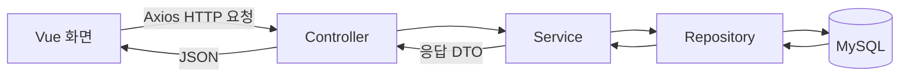
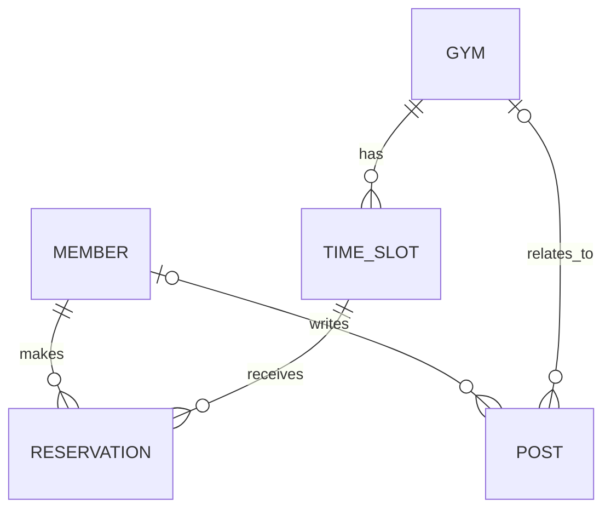

# Climbers’ Hub 프로젝트 정보

실제 DB의 컬럼·코멘트·키·관계는 [[엔티티]] 문서를 참고한다. 2026-10-30 소셜 계정 마이그레이션 후 테이블 6개, 컬럼 60개이며 모든 테이블·컬럼에 한글 DB 코멘트를 등록했다. 카카오 구현 설계·설정·테스트는 [[카카오 로그인 연동]]을 참고한다.

> 클라이밍장을 선택하고 날짜·시간대별로 예약하는 서비스. 암장 정보와 게시글 기능을 포함하며, 관리자 예약 승인·거절 기능을 목표로 한다.

## 분석 기준

- 확인일: 2026-10-30
- 백엔드: `C:\dev`
- 프론트엔드: `C:\dev_FE\climbers-hub`
- 소스·실제 MySQL 스키마를 확인했으며, ID 기반 세션 인증 테스트와 프론트엔드 빌드를 수행했다. 검증 범위는 아래 테스트 현황에 기록한다.

## 기술 구성

| 구분 | 사용 기술 |
| --- | --- |
| 백엔드 | Java 17, Spring Boot 3.5.4, Gradle |
| 데이터 접근 | Spring Data JPA, MySQL 드라이버 |
| 인증 | Spring Security, OAuth2 Client, BCrypt, HTTP 세션, CSRF 보호 |
| 보조 라이브러리 | Lombok, MapStruct, Springdoc OpenAPI |
| 외부 API 호출 | WebClient — 네이버 지오코딩 호출 |
| 프론트엔드 | Vue 3, JavaScript, Vite |
| 화면 및 상태 | Vue Router, Pinia, Bootstrap |
| HTTP 통신 | Axios |

> [!note] README와 실제 설정의 차이
> README에는 Maven, Spring Boot 3.3.2, React/Next.js 계획이 남아 있다. 현재 구현은 Gradle, Spring Boot 3.5.4, Vue 기반이므로 문서 갱신이 필요하다.

## 폴더 구조

### 백엔드

```text
C:\dev
├─ build.gradle
├─ settings.gradle
├─ gradlew / gradlew.bat
├─ src/main/java/com/climbers/hub
│  ├─ Application.java
│  ├─ auth          # 회원가입·로그인
│  ├─ social        # 소셜 계정 연결·카카오 OAuth2·제공자 설정
│  ├─ member        # 회원 관리·ID 기반 UserDetailsService
│  ├─ gym           # 클라이밍장 관리
│  ├─ post          # 게시글 관리
│  ├─ timeslot      # 예약 가능한 요일·시간대·정원
│  ├─ reservation   # 회원의 실제 예약
│  ├─ geocoding     # 주소 → 위도·경도
│  ├─ config        # Security, 세션, CSRF, CORS, 감사 설정 등
│  ├─ domain        # 공통 BaseEntity
│  └─ mapper        # MapStruct 데이터 변환
├─ src/main/resources/application.yaml
├─ src/main/generated  # 생성된 매퍼 코드
└─ src/test/java/com/climbers/hub
```

기능별 패키지 안에서 Controller, Service, Repository, Domain, DTO 역할을 나눈다. 모든 패키지에 이 구성 요소가 전부 있는 것은 아니다.

| 계층 | 역할 |
| --- | --- |
| Controller | HTTP 요청을 받아 서비스에 전달하고 응답을 반환 |
| Service | 조회·등록·권한 확인 등 업무 로직 처리 |
| Repository | JPA를 통한 DB 접근 |
| Domain | DB에 저장할 엔티티와 관계 정의 |
| DTO | 요청·응답에 필요한 데이터 정의 |

### 프론트엔드

```text
C:\dev_FE\climbers-hub
├─ package.json
├─ vite.config.js
├─ index.html
├─ public
└─ src
   ├─ main.js       # Vue 앱 생성, Router·Pinia·Bootstrap 등록
   ├─ App.vue       # 공통 화면 틀과 RouterView
   ├─ router/index.js
   ├─ views
   │  ├─ Login.vue
   │  ├─ Signup.vue
   │  └─ Home.vue        # 로그인 후 회원 정보·로그아웃
   ├─ stores/auth.js     # 로그인 상태 및 복원
   ├─ services/api.js    # 쿠키 전송·CSRF 공통 클라이언트
   ├─ components        # Vue 기본 예제 컴포넌트
   └─ assets            # CSS·이미지
```

## 요청 처리 흐름



예를 들어 암장 상세 요청은 `GET /gyms/{gymId}` → `GymController` → `GymService` → `GymRepository` 순서로 처리된다. 서비스는 암장을 찾은 뒤 상세 응답 DTO로 변환한다.

암장 등록 시에는 `GymService`가 `GeocodingService`를 호출하여 입력 주소를 좌표로 변환하고, 암장 정보와 함께 저장한다. WebClient를 사용하지만 현재 응답은 `.block()`으로 기다리는 방식이다.

## 주요 데이터 모델



| 모델 | 주요 정보 및 역할 |
| --- | --- |
| Member | 내부 member_id, 로그인 login_id, 이름, 이메일, 해싱된 비밀번호, 역할(USER/ADMIN). 소셜 전용 회원은 login_id·password·email NULL 허용 |
| SocialAccount | 제공자·제공자 사용자 ID와 내부 member_id 연결. 회원당 제공자별 1개 계정 |
| Gym | 이름, 설명, 주소, 연락처, 위도·경도, 운영시간, 가격 정보 |
| TimeSlot | 소속 암장, 요일, 시작·종료 시간, 정원 |
| Reservation | 예약 회원, 시간대, 실제 예약 날짜, 상태 |
| Post | 제목, 내용, 유형, 작성 회원, 선택적인 소속 암장 |
| BaseEntity | 생성·수정 시각과 생성·수정자 정보를 제공하는 공통 부모 |

`TimeSlot`은 “월요일 19:00~20:00, 정원 10명”처럼 반복되는 시간대를 나타낸다. `Reservation`은 “어떤 회원이 실제 어느 날짜의 시간대를 예약했는지”를 나타낸다.

- 예약 상태: `READY`, `CANCEL`, `DONE`
- 게시글 유형: `GYM_NOTICE`, `GYM_POST`, `GLOBAL_NOTICE`, `GLOBAL_POST`
- 관리자 승인·거절을 어떤 상태로 표현할지는 추가 설계가 필요하다.

## 기능별 진행 상태

2026-10-30: `DataInitializer`를 제거하고 인증을 ID·비밀번호 + 서버 세션으로 전환했다. 기존 회원 2명은 유지하고 로그인 ID를 `legacy_회원번호`로 채웠다. JWT 발급·검증 코드와 의존성 및 중복 인증 경로는 제거했다. MySQL의 JPA 설정은 `create-drop`에서 `validate`로 바꾸어 앱 기동·종료 시 테이블을 자동 생성·삭제하지 않도록 했다.

| 기능 | 백엔드 | 프론트엔드 |
| --- | --- | --- |
| 회원가입 | ID·이메일 중복 검사, 입력 검증, BCrypt 저장 | ID·이메일·이름·비밀번호 입력 및 가입 API 연결 |
| 로그인 | ID·비밀번호 검증, 세션 ID 교체·인증 정보 저장 | 로그인·CSRF 처리·홈 화면 이동 |
| 로그인 유지·로그아웃 | 내 정보 조회·세션 무효화 | Pinia, 새로고침·이동 시 복원, 로그아웃 |
| 카카오 로그인·계정 연결 | OAuth2 콜백·공통 회원 세션·중복 연결 방지 | 로그인 화면 카카오 버튼·회원 홈 연결 상태와 연결 버튼 |
| 회원 조회·수정 | 관리자 전용. 변경 메서드 사용 및 비밀번호 해싱 | 화면 없음 |
| 암장 등록·목록·상세 | API 및 서비스 코드 존재 | 화면 없음 |
| 암장 게시글 | 생성·조회·수정·삭제 코드 존재, 실제 로그인 사용자 연결 필요 | 화면 없음 |
| 시간대 | 엔티티·저장소·생성 서비스 존재, Controller 없음 | 화면 없음 |
| 예약 | 엔티티·저장소 존재, 서비스는 비어 있음 | 화면 없음 |
| 관리자 승인·거절 | 계획 단계 | 화면 없음 |

## 현재 API 구성

| 메서드 | 경로 | 역할 |
| --- | --- | --- |
| GET | `/api/auth/csrf` | CSRF 토큰과 헤더 이름 조회, 비로그인 허용 |
| POST | `/api/auth/signup` | ID·이름·이메일·비밀번호로 가입, CSRF 필요 |
| POST | `/api/auth/login` | ID·비밀번호 검증 후 세션 발급, CSRF 필요 |
| GET | `/api/auth/me` | 로그인한 회원 정보, 비로그인 시 401 |
| GET | `/api/auth/social/providers` | 소셜 제공자 활성 여부, 비로그인 허용 |
| GET | `/api/oauth2/authorization/kakao` | 카카오 인가 시작 |
| GET | `/api/login/oauth2/code/kakao` | 카카오 콜백, state 검증 |
| POST | `/api/auth/social/kakao/link` | 기존 로그인 회원의 카카오 연결 시작, CSRF 필요 |
| POST | `/api/auth/logout` | 세션 무효화·쿠키 삭제, CSRF 필요, 성공 204 |
| GET | `/member/list` | 전체 회원 조회, 관리자 전용 |
| GET / PATCH | `/member/{memberId}` | 회원 조회·수정, 관리자 전용 |
| GET | `/gyms` | 암장 목록 |
| GET | `/gyms/{gymId}` | 암장 상세 |
| POST | `/gyms/create` | 암장 등록 |
| POST | `/gyms/{gymId}/post` | 암장 게시글 생성 |
| GET | `/gyms/{gymId}/post/{postId}` | 암장 게시글 상세 |
| GET | `/gyms/{gymId}/posts` | 암장 게시글 목록 |
| PATCH / DELETE | `/post/{postId}` | 게시글 수정·삭제 |

## 프론트엔드 연결 상태

카카오 설정이 활성화되면 로그인 화면에 카카오 버튼을 표시한다. 회원 홈에서는 연결 상태·연결 버튼을 제공한다. 네이버·구글은 현재 버튼이나 실제 인증 기능을 제공하지 않으며 공통 소셜 계정 모델로 확장 가능하다. 상세 설계·실제 설정·오류 정책은 [[카카오 로그인 연동]] 참고.

공통 인증 화면 우측 하단 크레딧: `made by 전병찬` (로그인·회원가입·회원 홈 공통 적용).

2026-10-30 화면 개선: 로그인·회원가입·회원 홈에 공통 `AuthLayout.vue`를 적용했다. 숲색·라임색과 SVG 암벽 그래픽, 데스크톱 2열 및 모바일 1열 레이아웃을 사용한다. `assets/hub.css`에서 공통 스타일을 관리한다. 비밀번호 보기·숨기기 버튼과 가입 완료 안내를 추가하고 문서 언어·페이지 제목을 설정했다. 기존 세션 인증 흐름은 유지했다. 변경 파일 ESLint와 운영 빌드 통과. 브라우저에서 로그인·회원가입 화면, 모바일 가로 넘침 없음, 비밀번호 보기 토글을 확인했다. 회원 홈은 빌드 검증했으며 이번 디자인 작업에서는 계정 로그인 후 화면을 직접 검증하지 않았다.

- `/` → 로그인한 회원의 홈 화면. 비로그인 상태는 `/login`으로 이동한다.
- `/login` → 로그인 화면을 표시한다.
- `/signup` → 회원가입 화면을 표시한다.
- 로그인은 `/api/auth/login`을 호출한다. Vite가 `/api`를 `http://localhost:8080`으로 프록시한다.
- 인증 정보는 서버 세션에 저장하고 브라우저는 HttpOnly `JSESSIONID` 쿠키를 전송한다. localStorage에 인증 토큰을 저장하지 않으며 이전 토큰은 앱 시작 시 제거한다.
- Pinia의 `auth` 스토어가 로그인 회원 정보를 관리한다. 라우트 이동과 새로고침 시 `/api/auth/me`로 복원한다.
- 로그인·회원가입·로그아웃 전에 CSRF 토큰을 받아 요청 헤더에 전송한다. 로그인 성공 시 변경된 CSRF 토큰을 다시 조회한다.
- 백엔드 CORS 설정에는 `http://localhost:5173`이 허용되어 있다.

## 인증 구조와 정리할 부분

일반 로그인은 `loginId`·비밀번호를 검증하고, 카카오는 제공자의 안정적인 사용자 ID로 회원을 확인한다. 두 방식 모두 내부 `member_id`를 가진 `MemberPrincipal`을 사용하고 세션 ID를 교체한다. 쿠키는 HttpOnly, SameSite=Lax, 세션 유휴 시간은 30분이다. 개발 환경 HTTP에서는 Secure=false이며, HTTPS 운영 환경에서는 `SESSION_COOKIE_SECURE=true`를 설정해야 한다. 세션은 현재 서버 메모리에 저장되므로 서버 재시작 시 다시 로그인해야 한다. 감사 컬럼의 새 사용자 값은 내부 회원 번호 문자열이다.

### 인증 코드 중복

해결: 회원가입·로그인은 `/api/auth`로 통합했다. 사용자 조회는 `member`의 `CustomUserDetailsService` 한 곳에서 `login_id`를 기준으로 처리한다. 기존 `/member` 가입 및 `/member/login`은 제거했다.

### 회원가입 경로와 보안 설정 불일치

해결: CSRF 조회·가입·로그인을 비로그인 상태에서도 허용하고, 변경 요청에는 CSRF 토큰을 요구한다. 세션 없이 보호 자원에 접근하면 401, 권한 부족 또는 CSRF 오류는 403이다.

### 로그인 화면의 제출과 이동

해결: 폼 제출 이벤트 하나로 처리하고 중복 요청을 막는다. 성공 후 `/`에서 회원 이름·ID·이메일과 로그아웃 버튼을 표시한다.

### 게시글 작성자 연결

미해결: `PostController`의 작성·수정·삭제는 코드에 고정된 이메일을 사용한다. 세션으로 인증된 실제 사용자 정보를 사용하도록 연결해야 한다.

### 회원 수정 매핑 확인

변경: 회원 수정 서비스는 비어 있는 MapStruct 매퍼 대신 엔티티 변경 메서드를 사용하고 비밀번호를 BCrypt로 해싱한다. 회원 관리 API는 다른 회원 정보에 대한 접근을 막기 위해 관리자 전용으로 제한했다. 관리자 수정 성공 흐름은 이번 인증 테스트 범위에 포함하지 않았다.

## 테스트 현황

- `ApplicationTests`: 애플리케이션 컨텍스트 로딩
- `SessionAuthenticationTest`: 가입·해싱·ID/이메일 중복, ID 로그인 성공·실패, 이메일 로그인 거부, 세션 복원, 세션 ID 교체, CSRF 토큰 교체·누락 거부, 로그아웃 무효화, 입력 검증, 일반 회원의 회원 관리 API 접근 거부
- 기존 JWT 테스트는 세션 통합 테스트로 대체했다. 테스트 프로필은 실제 MySQL 대신 H2를 사용한다.
- `KakaoLoginTest` 및 `KakaoProfileTest`: 모의 제공자 응답으로 신규 가입·재로그인·기존 회원 연결·충돌·CSRF·state·유효 시간·일회성·세션 바인딩·독립 트랜잭션 검증. 제공자별 식별자 공간을 분리하여 같은 회원에게 네이버·구글 연결 레코드도 추가할 수 있는지 확인한다.
- 전체 테스트 결과는 [[카카오 로그인 연동]]의 검증 항목에 기록한다. H2 테스트 프로필은 실제 DB와 분리된다.
- 최종 `gradlew test`: 22개 통과, 실패 0. 프론트엔드 변경 파일 ESLint 및 `npm run build` 통과.
- 프론트엔드 `npm run build` 및 변경 파일 ESLint: 통과.
- 실제 HTTP 점검: CSRF 발급 200, HttpOnly 세션 쿠키 확인, 비로그인 `/me` 401, 유효 CSRF를 포함한 로그아웃 204. 실제 MySQL 계정 비밀번호를 사용한 로그인 및 브라우저 UI 수동 조작은 수행하지 않았으며, 가입·로그인 전체 흐름은 H2 + MockMvc로 검증했다.
- 실제 MySQL 마이그레이션 후 스키마 검증 모드로 서버 기동 성공. 회원 2명과 기존 외래 키 유지 확인.

카카오 작업 시 추가 검증: 실제 MySQL의 기존 회원 4명에 대한 행 해시가 적용 전후 일치함을 확인했다. 카카오 설정 활성화와 인가 시작 302, state 및 `http://localhost:5173/api/login/oauth2/code/kakao` 콜백 구성을 확인했다. 실제 카카오 계정의 로그인·동의 후 토큰 교환은 사용자의 최종 테스트가 필요하다. 검증용 18080 서버는 종료했다.

## 권장 개발 순서

- [x] 인증 경로와 서비스를 하나의 기준으로 정리
- [x] 보안 설정의 비로그인 허용 경로 수정
- [x] 프론트엔드 회원가입 API 연결
- [x] 로그인 폼 제출 이벤트 및 성공 후 이동 수정
- [x] 로그인 상태·공통 API 클라이언트·세션 쿠키·CSRF 전송 처리
- [ ] 암장 목록 및 상세 화면 연결
- [ ] 시간대 조회·관리 API 구현
- [ ] 예약 생성·내역 조회·취소 구현
- [ ] 날짜·시간대별 정원 확인 및 동시 예약 처리 검증
- [ ] 관리자 승인·거절과 권한 모델 구현
- [ ] 게시글을 실제 로그인 사용자와 연결
- [ ] README와 실행·설정 안내 갱신

첫 번째 완성 목표는 **회원가입 → 로그인 → 암장 목록 → 암장 상세** 흐름이다. 이후 시간대 선택과 예약을 붙여 핵심 사용 흐름을 완성한다.

## 실행 및 계정 안내

- Java 17로 백엔드 폴더에서 `gradlew.bat bootRun` 실행. 기본 포트 8080.
- 프론트엔드 폴더에서 `npm run dev` 실행 후 `http://localhost:5173` 접속. 개발 포트는 5173으로 고정한다.
- 회원가입에서 ID·이름·이메일·비밀번호를 입력한 뒤 ID·비밀번호로 로그인한다.
- ID는 소문자·숫자·밑줄 4~50자. 비밀번호는 8자 이상이며 UTF-8 기준 72바이트 이하. 이메일은 중복 불가이며 로그인 식별자로 사용하지 않는다.
- 기존 회원은 `legacy_회원번호`가 로그인 ID다. 비밀번호와 숫자 기본 키는 바꾸지 않았다.
- 기존 DB에 `schema/001_add_login_id.sql` 적용 완료. 다른 기존 DB로 옮길 때는 앱 시작 전에 1회 적용해야 하며 반복 실행용 SQL이 아니다. 신규 빈 DB의 전체 스키마 생성은 이 SQL의 범위에 포함되지 않는다.
- 운영 배포에서는 `/api`를 백엔드로 전달하는 동일 출처 프록시 및 HTTPS 구성이 필요하다. Vite의 개발 프록시는 운영 빌드에 포함되지 않는다.
- 카카오 로그인 및 일반 회원의 카카오 연결은 구현했다. 비밀번호 재설정·이메일 검증·로그인 시도 제한·네이버/구글 실제 연동·연결 해제·계정 병합은 아직 구현하지 않았다.

## DB 코멘트 관리

2026-10-30 복구: 변경 전 `create-drop` 설정으로 실행 중이던 기존 서버 종료 후 테이블 5개가 모두 사라진 것을 확인했다. 종료 직전 백업에서 스키마·데이터·코멘트를 복원했고, 5개 테이블의 CHECKSUM이 종료 전과 일치함을 검증했다. 현재 소스의 `ddl-auto`는 `validate`다.

복원 후 임시 18080 포트에서 서버 기동 및 스키마 검증 성공을 확인했다. 검증 서버 종료 후에도 5개 테이블의 CHECKSUM이 동일하여 테이블과 데이터가 유지됨을 재확인했다. 검증 서버는 종료했다.

2026-10-30: `schema/002_add_table_column_comments.sql`로 테이블 5개와 컬럼 52개에 한글 코멘트를 적용했다. 전후 DDL에서 코멘트 외 정의가 동일하고 모든 테이블의 CHECKSUM이 일치하는 것을 확인했다. 상세 코멘트는 [[엔티티]]에 반영했다.
