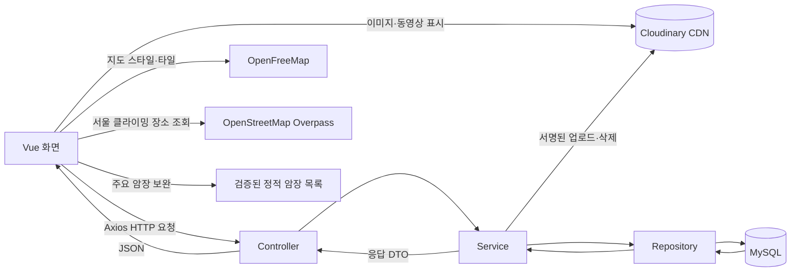
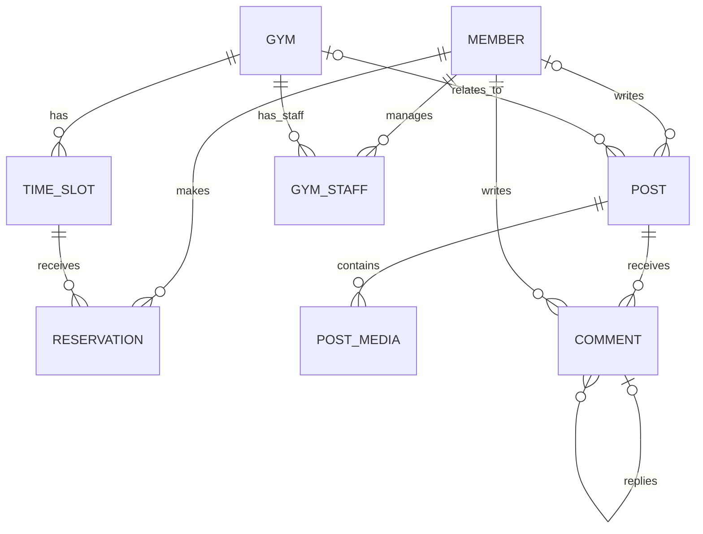

# Climbers’ Hub 프로젝트 정보

실제 DB의 컬럼·코멘트·키·관계는 [[엔티티]] 문서를 참고한다. 2026-11-27 Aiven 공유 DB의 회원 프로필 사진 마이그레이션 후 테이블 9개, 컬럼 97개이며 모든 테이블·컬럼에 한글 DB 코멘트를 등록했다. 카카오 구현 설계·설정·테스트는 [[카카오 로그인 연동]]을 참고한다.

> 클라이밍장을 선택하고 날짜·시간대별로 예약하는 서비스. 암장 정보와 게시글 기능을 포함하며, 관리자 예약 승인·거절 기능을 목표로 한다.

## Codex 작업 지침

> [!important] 작업 시작 순서
> 새 Codex 채팅에서는 **이 문서를 먼저 읽고**, 현재 프로젝트 상태를 파악한 다음 사용자의 최신 명령을 처리한다. 같은 채팅의 후속 요청에서는 문서 전체를 반복해서 읽지 않고 관련 부분만 확인한다.

### 기본 원칙

1. `C:\dev\토이프로젝트_저장소\Project_info.md`를 기준으로 구현된 기능, 미구현 기능, 검증 상태와 폴더 위치를 확인한다.
2. DB·엔티티 작업이면 `C:\dev\토이프로젝트_저장소\엔티티.md`도 확인한다. 카카오 연동 작업이면 `카카오 로그인 연동.md`를 추가로 확인한다.
3. 문서 확인 후 사용자의 **가장 최근 명령**을 작업 목표로 삼는다. 문서가 사용자 명령보다 우선하지 않는다.
4. 문서와 실제 코드가 다르면 최소 범위로 코드를 확인하고 실제 구현을 기준으로 판단한다. 작업이 끝나면 문서를 실제 상태에 맞게 수정한다.
5. 필요한 선택이 결과를 크게 바꾸지 않는다면 합리적인 기본값으로 진행한다. 권한, 데이터 삭제, 외부 배포처럼 중요한 결정이 필요할 때만 질문한다.

### 프로젝트 경로

- 백엔드 및 백엔드 Git 저장소: `C:\dev`
- 프론트엔드 및 프론트엔드 Git 저장소: `C:\dev_FE\climbers-hub`
- 프로젝트 문서: `C:\dev\토이프로젝트_저장소`
- 백엔드 로컬 포트: `8081`
- 프론트엔드 개발 서버 기본 포트: `5173`

### 토큰과 작업 시간 절약

- 파일 검색은 `rg` 또는 `rg --files`로 시작하고, 기능과 직접 관련된 파일만 읽는다. 필요하지 않은 디렉터리 전체 목록이나 대용량 파일 전체 내용을 출력하지 않는다.
- 이 문서는 새 채팅에서 한 번만 전체 확인한다. 같은 채팅에서는 변경된 기능의 관련 절과 필요한 소스만 확인한다.
- 인터넷 검색은 최신 외부 정보, 공식 문서 또는 사용자가 지정한 페이지가 필요한 경우에만 수행한다.
- 변경은 가능한 한 작은 패치로 나누되, 같은 검증 명령을 불필요하게 반복하지 않는다.
- 프론트엔드는 구현 완료 후 `format` → `lint` → `build`를 기본적으로 한 번 실행한다. 오류를 수정했을 때만 다시 실행한다.
- 백엔드는 변경 범위에 맞는 테스트를 먼저 실행한다. 전체 회귀 위험이 있거나 공통 인증·DB 구조를 변경한 경우에만 전체 테스트를 실행한다.
- 중간 설명과 최종 보고는 간결하게 작성하고, 변경 파일·검증 결과·남은 미검증 사항을 중심으로 전달한다.
- 서브에이전트나 병렬 작업은 사용자가 명시적으로 요청한 경우에만 사용한다.

### 변경 및 안전 규칙

- 기존 작업 트리의 사용자 변경을 보존한다. 관련 없는 파일을 되돌리거나 정리하지 않는다.
- Git 커밋, push, 브랜치 변경, 외부 배포는 사용자가 명시적으로 요청했을 때만 수행한다.
- DB DDL·데이터 변경은 요청 범위와 대상 DB를 확인한 뒤 수행한다. 삭제 또는 복구하기 어려운 변경은 실행 전에 정확한 대상을 확인한다.
- `application-secret.yaml`, 환경 변수, DB 비밀번호, OAuth 키, JWT 비밀 값 등은 문서·응답·로그에 노출하지 않는다.
- 새로운 라이브러리는 기존 기술로 해결하기 어려울 때만 추가하고, 추가 이유를 기록한다.
- 아직 없는 운영시간·가격·예약 가능 여부 같은 정보는 추측해서 만들지 않는다. 화면에는 미제공 또는 준비 중 상태를 명확히 표시한다.

### 문서 및 검증 규칙

- 백엔드 또는 프론트엔드 기능을 추가·변경·삭제하면 같은 작업에서 이 문서의 기능 상태, 화면 흐름, API, 체크리스트와 검증 기록을 갱신한다.
- 엔티티 또는 DB 스키마를 변경하면 `엔티티.md`의 컬럼, 키, 관계와 코멘트도 함께 갱신한다.
- 실제 실행한 테스트만 통과했다고 기록한다. 브라우저 조작, 실제 외부 API, 실제 DB 검증을 하지 않았다면 미검증이라고 명시한다.
- 해결된 문제는 미해결 목록에서 제거하거나 해결 상태로 변경한다. 새로 발견한 미구현 항목은 구현 완료 항목과 구분한다.

## 분석 기준

- 확인일: 2026-11-24
- 백엔드: `C:\dev`
- 프론트엔드: `C:\dev_FE\climbers-hub`
- 소스·실제 MySQL 스키마를 확인했으며, ID 기반 세션 인증 테스트와 프론트엔드 빌드를 수행했다. 검증 범위는 아래 테스트 현황에 기록한다.

## 기술 구성

| 구분 | 사용 기술 |
| --- | --- |
| 백엔드 | Java 17, Spring Boot 3.5.4, Gradle |
| 데이터 접근 | Spring Data JPA, MySQL 드라이버 |
| 인증 | Spring Security, OAuth2 Client, BCrypt, HTTP 세션, CSRF 보호 |
| 미디어 저장 | Cloudinary Java SDK 2.6.0 — 이미지·동영상 저장 및 HTTPS 전달 |
| 보조 라이브러리 | Lombok, MapStruct, Springdoc OpenAPI |
| 지도·장소 검색 | MapLibre GL JS 6.19.0 + OpenFreeMap 지도 + OpenStreetMap Overpass 공개 장소 데이터 |
| 외부 API 호출 | WebClient — 네이버 지오코딩 호출 |
| 프론트엔드 | Vue 3, JavaScript, Vite |
| 화면 및 상태 | Vue Router, Pinia, Bootstrap |
| HTTP 통신 | Axios |

> [!note] README와 실제 설정의 차이
> README에는 Maven, Spring Boot 3.3.2, React/Next.js 계획이 남아 있다. 현재 구현은 Gradle, Spring Boot 3.5.4, Vue 기반이므로 문서 갱신이 필요하다.

## 폴더 구조

### 백엔드

```text
C:\dev
├─ build.gradle
├─ settings.gradle
├─ gradlew / gradlew.bat
├─ src/main/java/com/climbers/hub
│  ├─ Application.java
│  ├─ auth          # 회원가입·로그인
│  ├─ social        # 소셜 계정 연결·카카오 OAuth2·제공자 설정
│  ├─ member        # 회원 관리·ID 기반 UserDetailsService
│  ├─ gym           # 클라이밍장 관리
│  ├─ post          # 게시글 관리
│  ├─ media         # Cloudinary 설정·업로드·삭제 추상화
│  ├─ timeslot      # 예약 가능한 요일·시간대·정원
│  ├─ reservation   # 회원의 실제 예약
│  ├─ geocoding     # 주소 → 위도·경도
│  ├─ config        # Security, 세션, CSRF, CORS, 감사 설정 등
│  ├─ domain        # 공통 BaseEntity
│  └─ mapper        # MapStruct 데이터 변환
├─ src/main/resources/application.yaml
├─ src/main/generated  # 생성된 매퍼 코드
└─ src/test/java/com/climbers/hub
```

기능별 패키지 안에서 Controller, Service, Repository, Domain, DTO 역할을 나눈다. 모든 패키지에 이 구성 요소가 전부 있는 것은 아니다.

| 계층 | 역할 |
| --- | --- |
| Controller | HTTP 요청을 받아 서비스에 전달하고 응답을 반환 |
| Service | 조회·등록·권한 확인 등 업무 로직 처리 |
| Repository | JPA를 통한 DB 접근 |
| Domain | DB에 저장할 엔티티와 관계 정의 |
| DTO | 요청·응답에 필요한 데이터 정의 |

### 프론트엔드

```text
C:\dev_FE\climbers-hub
├─ package.json
├─ vite.config.js
├─ index.html
├─ public
└─ src
   ├─ main.js       # Vue 앱 생성, Router·Pinia·Bootstrap 등록
   ├─ App.vue       # 공통 화면 틀과 RouterView
   ├─ router/index.js
   ├─ views
   │  ├─ Login.vue
   │  ├─ Signup.vue
   │  ├─ Home.vue        # 로그인 후 자유게시판·미디어 첨부
   │  ├─ Account.vue     # 회원 정보·소셜 연결·로그아웃
   │  ├─ ProfileSettings.vue
   │  ├─ GymMap.vue      # 서울 암장 지도·목록·장소 요약
   │  └─ GymDetail.vue   # 암장 방문 정보·위치 지도·외부 링크 상세
   ├─ stores/auth.js     # 로그인 상태 및 복원
   ├─ services
   │  ├─ api.js          # 쿠키 전송·CSRF 공통 클라이언트
   │  └─ openStreetMapGyms.js # 서울 암장 공개 데이터 조회·보완 목록 병합·세션 캐시
   ├─ data
   │  └─ seoulCuratedGyms.js  # OSM 누락에 대비한 검증된 서울 주요 암장 목록
   ├─ components        # 공통 인증 레이아웃·카카오 버튼·댓글 스레드
   └─ assets            # CSS·이미지
```

## 요청 처리 흐름



예를 들어 암장 상세 요청은 `GET /gyms/{gymId}` → `GymController` → `GymService` → `GymRepository` 순서로 처리된다. 서비스는 암장을 찾은 뒤 상세 응답 DTO로 변환한다.

암장 등록 시에는 `GymService`가 `GeocodingService`를 호출하여 입력 주소를 좌표로 변환하고, 암장 정보와 함께 저장한다. WebClient를 사용하지만 현재 응답은 `.block()`으로 기다리는 방식이다.

## 주요 데이터 모델



| 모델 | 주요 정보 및 역할 |
| --- | --- |
| Member | 내부 member_id, 로그인 login_id, 이름, 이메일, 해싱된 비밀번호, 역할(USER/ADMIN). 소셜 전용 회원은 login_id·password·email NULL 허용 |
| SocialAccount | 제공자·제공자 사용자 ID와 내부 member_id 연결. 회원당 제공자별 1개 계정 |
| Gym | 이름, 설명, 주소, 연락처, 위도·경도, 운영시간, 가격, 외부 출처·ID, 검증 상태, 활성 여부, 검증 시각 |
| GymStaff | 회원과 암장 사이의 운영 권한. 전역 USER/ADMIN 역할과 분리하며 현재 암장별 OWNER를 표현 |
| TimeSlot | 소속 암장, 요일, 시작·종료 시간, 정원 |
| Reservation | 예약 회원, 시간대, 실제 예약 날짜, 상태 |
| Post | 제목, 내용, 유형, 작성 회원, 선택적인 소속 암장 |
| BaseEntity | 생성·수정 시각과 생성·수정자 정보를 제공하는 공통 부모 |

`TimeSlot`은 “월요일 19:00~20:00, 정원 10명”처럼 반복되는 시간대를 나타낸다. `Reservation`은 “어떤 회원이 실제 어느 날짜의 시간대를 예약했는지”를 나타낸다.

- 예약 상태: `READY`, `CANCEL`, `DONE`
- 게시글 유형: `GYM_NOTICE`, `GYM_POST`, `GLOBAL_NOTICE`, `GLOBAL_POST`
- 관리자 승인·거절을 어떤 상태로 표현할지는 추가 설계가 필요하다.

## 기능별 진행 상태

2026-10-30: `DataInitializer`를 제거하고 인증을 ID·비밀번호 + 서버 세션으로 전환했다. 기존 회원 2명은 유지하고 로그인 ID를 `legacy_회원번호`로 채웠다. JWT 발급·검증 코드와 의존성 및 중복 인증 경로는 제거했다. MySQL의 JPA 설정은 `create-drop`에서 `validate`로 바꾸어 앱 기동·종료 시 테이블을 자동 생성·삭제하지 않도록 했다.

| 기능 | 백엔드 | 프론트엔드 |
| --- | --- | --- |
| 회원가입 | ID·이메일 중복 검사, 입력 검증, BCrypt 저장 | ID·이메일·이름·비밀번호 입력 및 가입 API 연결 |
| 로그인 | ID·비밀번호 검증, 세션 ID 교체·인증 정보 저장 | 로그인·CSRF 처리·홈 화면 이동 |
| 로그인 유지·로그아웃 | 내 정보 조회·세션 무효화 | Pinia, 새로고침·이동 시 복원, 로그아웃 |
| 카카오 로그인·계정 연결 | OAuth2 콜백·공통 회원 세션·중복 연결 방지 | 로그인 화면 카카오 버튼·회원 홈 연결 상태와 연결 버튼 |
| 내 계정 상세·개인정보 수정 | 본인 세션 기준 이름·이메일 수정, 이메일 중복 검사, 현재 비밀번호 확인 후 비밀번호 변경. Cloudinary 프로필 사진 업로드·교체·삭제와 실패 시 신규 파일 정리 | `/account`에서 프로필 사진 미리보기·저장·삭제, 이름·이메일, 비밀번호, 소셜 연결, 관리자 메뉴를 한곳에서 관리. `/settings/profile`은 `/account`로 이동 |
| 회원·암장 관리인 관리 | 기존 USER/ADMIN 유지. 내부적으로 `gym_staff` OWNER 관계를 사용하며 회원별·암장별 관리인 지정/수정/삭제 API 제공. `/api/admin/**`는 ADMIN만 접근 가능. Aiven에 `schema/007_gym_staff.sql` 적용 완료 | `/admin/gym-owners`의 암장 셀렉트 박스에서 암장을 고르고 이름·로그인 ID·이메일·권한으로 회원을 검색해 관리인을 지정한다. 현재 관리인 정보와 수정·삭제 버튼을 표시하며 ADMIN만 라우트 접근 가능 |
| 암장 등록·목록·상세 | `/api/gyms`는 REJECTED를 제외한 DB 암장 목록, `/api/gyms/{gymId}`는 VERIFIED·활성 암장 상세를 제공. Aiven 66곳: VERIFIED·활성 57곳, PENDING·비활성 9곳 | `/gyms`가 DB 66곳을 표시. PENDING은 회색·선택 불가, VERIFIED만 `/gyms/:gymId` DB 상세로 이동. 운영시간·전화·가격 미제공 상태 표시 |
| 전체 자유게시판 | 세션 회원 기준 목록·상세·작성·수정·삭제, 작성자 권한 검사 | 로그인 직후 `/`에서 목록·검색·작성·본인 글 삭제 |
| 이미지·동영상 첨부 | Cloudinary 업로드·메타데이터 저장·실패 보상 삭제·게시글 삭제 후 원본 정리 | 최대 5개 미리보기·업로드, 이미지·동영상 그리드 표시 |
| 댓글·대댓글 | 세션 회원 기준 작성·삭제, 자기참조 부모, 한 단계 깊이 제한 | 댓글 펼치기·작성·답글·본인 댓글 삭제 |
| 암장 게시글 | 세션 회원 기준 생성·조회·수정·삭제, 작성자는 `member_id`로 확인 | 화면 없음 |
| 시간대 | 엔티티·저장소·생성 서비스 존재, Controller 없음 | 화면 없음 |
| 예약 | 엔티티·저장소 존재, 서비스는 비어 있음 | 화면 없음 |
| 관리자 승인·거절 | 계획 단계 | 화면 없음 |

## 현재 API 구성

| 메서드 | 경로 | 역할 |
| --- | --- | --- |
| GET | `/api/auth/csrf` | CSRF 토큰과 헤더 이름 조회, 비로그인 허용 |
| POST | `/api/auth/signup` | ID·이름·이메일·비밀번호로 가입, CSRF 필요 |
| POST | `/api/auth/login` | ID·비밀번호 검증 후 세션 발급, CSRF 필요 |
| GET | `/api/auth/me` | 로그인한 회원 정보, 비로그인 시 401 |
| GET | `/api/auth/social/providers` | 소셜 제공자 활성 여부, 비로그인 허용 |
| GET | `/api/oauth2/authorization/kakao` | 카카오 인가 시작 |
| GET | `/api/login/oauth2/code/kakao` | 카카오 콜백, state 검증 |
| POST | `/api/auth/social/kakao/link` | 기존 로그인 회원의 카카오 연결 시작, CSRF 필요 |
| POST | `/api/auth/logout` | 세션 무효화·쿠키 삭제, CSRF 필요, 성공 204 |
| PATCH | `/api/members/me/profile` | 현재 로그인 회원의 이름·이메일 수정, CSRF 필요 |
| PATCH | `/api/members/me/password` | 현재 비밀번호 확인 후 새 비밀번호 저장, CSRF 필요, 성공 204 |
| POST | `/api/members/me/profile-image` | JPG·PNG·WEBP·GIF 프로필 사진 업로드/교체, 최대 5MB, multipart·CSRF 필요 |
| DELETE | `/api/members/me/profile-image` | 현재 프로필 사진과 Cloudinary 원본 삭제, CSRF 필요 |
| GET | `/api/admin/gym-owners` | 회원·내부 암장·현재 OWNER 목록 조회, 관리자 전용 |
| POST | `/api/admin/gyms/{gymId}/owners` | 회원을 해당 암장의 OWNER로 지정, 관리자·CSRF 필요 |
| PATCH | `/api/admin/gyms/{gymId}/owners/{memberId}` | 현재 암장 관리인을 다른 회원으로 교체, 관리자·CSRF 필요 |
| DELETE | `/api/admin/gyms/{gymId}/owners/{memberId}` | 해당 회원의 암장 OWNER 권한 해제, 관리자·CSRF 필요 |
| GET / POST | `/api/posts` | 전체 자유게시판 목록·작성, 작성은 CSRF 필요 |
| POST | `/api/posts` (`multipart/form-data`) | JSON 게시글과 이미지·동영상 파일을 함께 작성, CSRF 필요 |
| GET | `/api/posts/{postId}` | 전체 자유게시판 글 상세 |
| PATCH / DELETE | `/api/posts/{postId}` | 작성자 본인의 게시글 수정·삭제, CSRF 필요 |
| GET / POST | `/api/posts/{postId}/comments` | 댓글·대댓글 목록 및 작성, 작성은 CSRF 필요 |
| DELETE | `/api/comments/{commentId}` | 작성자 본인의 댓글 삭제, 최상위 삭제 시 대댓글 함께 삭제 |
| GET | `/member/list` | 전체 회원 조회, 관리자 전용 |
| GET / PATCH | `/member/{memberId}` | 회원 조회·수정, 관리자 전용 |
| GET | `/api/gyms` | REJECTED를 제외한 DB 암장 목록. PENDING 포함 |
| GET | `/api/gyms/{gymId}` | VERIFIED·활성 암장 상세. 그 외 404 |
| POST | `/api/gyms/create` | 암장 등록 |
| POST | `/gyms/{gymId}/post` | 암장 게시글 생성 |
| GET | `/gyms/{gymId}/post/{postId}` | 암장 게시글 상세 |
| GET | `/gyms/{gymId}/posts` | 암장 게시글 목록 |
| PATCH / DELETE | `/post/{postId}` | 게시글 수정·삭제 |

## 프론트엔드 연결 상태

카카오 설정이 활성화되면 로그인 화면에 카카오 버튼을 표시한다. 회원 홈에서는 연결 상태·연결 버튼을 제공한다. 네이버·구글은 현재 버튼이나 실제 인증 기능을 제공하지 않으며 공통 소셜 계정 모델로 확장 가능하다. 상세 설계·실제 설정·오류 정책은 [[카카오 로그인 연동]] 참고.

공통 인증 화면 우측 하단 크레딧: `made by 전병찬` (로그인·회원가입·회원 홈 공통 적용).

2026-10-30 화면 개선: 로그인·회원가입·회원 홈에 공통 `AuthLayout.vue`를 적용했다. 숲색·라임색과 SVG 암벽 그래픽, 데스크톱 2열 및 모바일 1열 레이아웃을 사용한다. `assets/hub.css`에서 공통 스타일을 관리한다. 비밀번호 보기·숨기기 버튼과 가입 완료 안내를 추가하고 문서 언어·페이지 제목을 설정했다. 기존 세션 인증 흐름은 유지했다. 변경 파일 ESLint와 운영 빌드 통과. 브라우저에서 로그인·회원가입 화면, 모바일 가로 넘침 없음, 비밀번호 보기 토글을 확인했다. 회원 홈은 빌드 검증했으며 이번 디자인 작업에서는 계정 로그인 후 화면을 직접 검증하지 않았다.

2026-11-27 로그인·회원가입·개인정보 설정의 모든 비밀번호 입력에 공통 눈 아이콘 보기·숨기기 버튼을 적용했다. 개인정보 설정의 현재 비밀번호·새 비밀번호·새 비밀번호 확인은 각각 독립적으로 전환하며 `aria-label`과 `aria-pressed`로 상태를 제공한다. 프론트엔드 포맷·린트·운영 빌드 통과, 실제 브라우저 포인터 조작은 미검증이다.

- `/` → 로그인 직후 표시하는 전체 자유게시판. 최신순 목록·검색·글 작성·본인 글 삭제를 제공하며 비로그인 상태는 `/login`으로 이동한다.
- `/account` → 프로필 사진, 로그인 ID·권한 확인, 이름·이메일 수정, 비밀번호 변경, 카카오 연결, 관리자 메뉴와 로그아웃을 제공하는 내 계정 상세 화면.
- `/login` → 로그인 화면을 표시한다.
- `/signup` → 회원가입 화면을 표시한다.
- `/settings/profile` → 기존 주소 호환을 위해 `/account`로 리다이렉트한다.
- `/admin/gym-owners` → ADMIN 전용 **암장 관리인 지정** 화면. 왼쪽 셀렉트 박스로 내부 암장을 선택하고 오른쪽에서 현재 관리인의 이름·로그인 ID·이메일을 확인한다. 이름·로그인 ID·이메일·권한으로 회원을 검색하여 새 관리인을 지정하거나 기존 관리인을 다른 회원으로 수정·삭제한다. 내부 `gym` 행이 없으면 먼저 암장을 등록해야 한다는 빈 상태를 표시한다.
- `/gyms` → DB의 서울 암장 66곳을 MapLibre·OpenFreeMap 지도와 목록에 표시한다. PENDING 9곳은 회색 마커·목록으로 보이지만 비활성 버튼이라 선택할 수 없고, VERIFIED·활성 암장만 상세로 이동한다.
- `/gyms/:gymId` → 내부 숫자 `gym_id`로 DB 상세를 조회하여 이름·주소·전화·설명·운영시간·가격·좌표와 단일 위치 지도를 표시한다. VERIFIED·활성 암장만 조회할 수 있고 가격 미제공 시 준비 중으로 안내한다.
- 로그인은 `/api/auth/login`을 호출한다. 로컬 백엔드는 반복되는 8080 포트 충돌을 피하기 위해 8081을 사용하며, Vite가 `/api`를 `http://localhost:8081`로 프록시한다.
- 인증 정보는 서버 세션에 저장하고 브라우저는 HttpOnly `JSESSIONID` 쿠키를 전송한다. localStorage에 인증 토큰을 저장하지 않으며 이전 토큰은 앱 시작 시 제거한다.
- Pinia의 `auth` 스토어가 로그인 회원 정보를 관리한다. 라우트 이동과 새로고침 시 `/api/auth/me`로 복원한다.
- 게시판 상단의 ‘내 계정’에서 `/account` 상세로 이동한다. 기본 정보와 프로필 사진 저장·삭제 성공 시 API 응답으로 Pinia 회원 정보를 즉시 갱신한다.
- 게시글 작성 폼은 이미지·동영상 최대 5개를 미리 보여준 뒤 multipart로 전송한다. JPG·PNG·WEBP·GIF는 개별 10MB, MP4·WEBM·MOV는 개별 50MB, 전체 100MB로 제한한다.
- 게시글의 댓글 보기를 누르면 댓글을 지연 조회한다. 최상위 댓글과 한 단계 대댓글을 작성할 수 있고 본인이 쓴 댓글만 삭제 버튼을 표시한다.
- 로그인·회원가입·로그아웃 전에 CSRF 토큰을 받아 요청 헤더에 전송한다. 로그인 성공 시 변경된 CSRF 토큰을 다시 조회한다.
- 백엔드 CORS 설정에는 `http://localhost:5173`이 허용되어 있다.

### 오픈 지도 데이터 구성

- 별도의 지도 계정·API 키·`.env.local` 설정 없이 사용한다. 카카오 로그인 설정과도 무관하다.
- MapLibre는 Vite worker를 별도 번들로 만들고 `https://tiles.openfreemap.org/styles/liberty` 스타일을 사용한다.
- OpenStreetMap Overpass 공개 서버에서 서울 경계 좌표 안의 `sport=climbing` 또는 이름에 클라이밍·볼더링 관련 단어가 있는 장소를 조회한다. 주 서버 실패 시 대체 공개 서버를 사용한다.
- OSM 누락을 보완하기 위해 공개된 지점 주소를 확인한 피커스 종로·구로·신촌, 서울숲클라이밍 구로·종로·잠실·영등포, 더클라임 신림·연남·성수·문래·이수·양재·사당·마곡·논현·강남, 온플릭 천호, 오프더월 이태원을 정적 목록으로 포함한다. 지도 좌표는 주소 기반 공개 지오코딩 결과를 사용하며, OSM 장소와 이름·거리 기준으로 중복 제거한다.
- 정적 목록은 Overpass가 실패해도 즉시 사용할 수 있다. Overpass 요청은 서버별 5초로 제한하고, 지도 스타일 로딩과 암장 데이터 조회를 동시에 시작한다.
- 공개 서버의 불필요한 반복 호출을 피하려고 정상 조회 결과를 브라우저 `sessionStorage`에 6시간 캐시한다. 화면의 다시 시도는 캐시를 무시하고 새로 조회한다.
- OpenStreetMap 공개 데이터는 실제 정보와 다르거나 일부 암장이 누락될 수 있다. 지도와 화면에 OpenFreeMap·OpenStreetMap 출처를 표시한다.
- 2026-11-27 [Climb Map 서울 실내 암장 목록](https://climbmap.life/places/kr/seoul/indoor)과 개별 장소 페이지를 다시 확인하여 66곳을 Aiven `gym`에 CURATED 데이터로 저장했다. 공개 페이지에 `운영 검수 완료`가 있는 57곳은 VERIFIED·활성, 근거가 부족한 9곳은 PENDING·비활성이다. 실시간 Overpass 결과는 자동 저장하지 않으며 프론트엔드 지도도 아직 DB 목록을 읽지 않는다.

## 인증 구조와 정리할 부분

일반 로그인은 `loginId`·비밀번호를 검증하고, 카카오는 제공자의 안정적인 사용자 ID로 회원을 확인한다. 두 방식 모두 내부 `member_id`를 가진 `MemberPrincipal`을 사용하고 세션 ID를 교체한다. 쿠키는 HttpOnly, SameSite=Lax, 세션 유휴 시간은 30분이다. 개발 환경 HTTP에서는 Secure=false이며, HTTPS 운영 환경에서는 `SESSION_COOKIE_SECURE=true`를 설정해야 한다. 세션은 현재 서버 메모리에 저장되므로 서버 재시작 시 다시 로그인해야 한다. 감사 컬럼의 새 사용자 값은 내부 회원 번호 문자열이다.

개인정보 수정 API는 URL이나 요청 본문으로 회원 번호를 받지 않고 현재 인증 세션의 `member_id`만 사용한다. 이름은 필수이고 이메일은 선택이며, 이메일을 입력하면 소문자로 정규화하고 다른 회원과의 중복을 거부한다. 일반 로그인 비밀번호 변경은 현재 비밀번호 일치 여부와 새 비밀번호 8~72자·UTF-8 72바이트 제한을 확인한 뒤 BCrypt로 다시 해싱하며, 성공 시 세션 ID를 교체한다. 소셜 전용 회원에게는 비밀번호 변경 폼을 표시하지 않고 서버에서도 변경을 거부한다.

### 인증 코드 중복

해결: 회원가입·로그인은 `/api/auth`로 통합했다. 사용자 조회는 `member`의 `CustomUserDetailsService` 한 곳에서 `login_id`를 기준으로 처리한다. 기존 `/member` 가입 및 `/member/login`은 제거했다.

### 회원가입 경로와 보안 설정 불일치

해결: CSRF 조회·가입·로그인을 비로그인 상태에서도 허용하고, 변경 요청에는 CSRF 토큰을 요구한다. 세션 없이 보호 자원에 접근하면 401, 권한 부족 또는 CSRF 오류는 403이다.

### 로그인 화면의 제출과 이동

해결: 폼 제출 이벤트 하나로 처리하고 중복 요청을 막는다. 일반·카카오 로그인 성공 후 `/`의 전체 자유게시판으로 이동한다. 회원 정보·카카오 계정 연결·로그아웃은 `/account`에서 제공한다.

### 게시글 작성자 연결

해결: 고정 이메일을 제거하고 `MemberPrincipal.memberId`로 작성자를 조회한다. 전체 자유게시판과 암장 게시글 모두 현재 세션 회원을 작성자로 저장하며, 수정·삭제는 게시글의 `member_id`와 현재 회원 번호가 같은 경우만 허용한다. 이메일이 없는 소셜 전용 회원도 동일하게 게시글을 작성할 수 있다.

### 회원 수정 매핑 확인

변경: 회원 수정 서비스는 비어 있는 MapStruct 매퍼 대신 엔티티 변경 메서드를 사용하고 비밀번호를 BCrypt로 해싱한다. 회원 관리 API는 다른 회원 정보에 대한 접근을 막기 위해 관리자 전용으로 제한했다. 관리자 수정 성공 흐름은 이번 인증 테스트 범위에 포함하지 않았다.

## 테스트 현황

- `ApplicationTests`: 애플리케이션 컨텍스트 로딩
- `SessionAuthenticationTest`: 가입·해싱·ID/이메일 중복, ID 로그인 성공·실패, 이메일 로그인 거부, 세션 복원, 세션 ID 교체, CSRF 토큰 교체·누락 거부, 로그아웃 무효화, 입력 검증, 일반 회원의 회원 관리 API 접근 거부, 본인 이름·이메일 수정, 중복 이메일 거부, 현재 비밀번호 확인, 비밀번호 재해싱 및 기존 비밀번호 로그인 거부, 프로필 사진 업로드·삭제와 동영상 거부
- 기존 JWT 테스트는 세션 통합 테스트로 대체했다. 테스트 프로필은 실제 MySQL 대신 H2를 사용한다.
- `KakaoLoginTest` 및 `KakaoProfileTest`: 모의 제공자 응답으로 신규 가입·재로그인·기존 회원 연결·충돌·CSRF·state·유효 시간·일회성·세션 바인딩·독립 트랜잭션 검증. 제공자별 식별자 공간을 분리하여 같은 회원에게 네이버·구글 연결 레코드도 추가할 수 있는지 확인한다.
- `PostApiTest`: 인증 사용자만 전체 게시판을 조회·작성할 수 있는지, CSRF 누락 거부, 세션 회원의 작성자 저장, 목록·상세·수정·삭제, 다른 회원의 수정·삭제 거부, 모의 Cloudinary 미디어 메타데이터 저장, 댓글·대댓글 작성, 깊이 제한, 댓글 삭제 권한과 연쇄 삭제를 검증한다.
- `GymOwnerAdminApiTest`: 일반 회원의 관리자 API 접근 거부, 관리자 관리 데이터 조회, 관리인 지정, 중복 지정 거부, 다른 회원으로 교체, 관리인 삭제를 검증한다.
- `GymMetadataTest`: 관리자 입력 암장의 기본 출처 ADMIN, 검증 대기 PENDING, 활성 상태와 외부 ID·검증 시각 초기값을 검증한다.
- 전체 테스트 결과는 [[카카오 로그인 연동]]의 검증 항목에 기록한다. H2 테스트 프로필은 실제 DB와 분리된다.
- 2026-11-24 개인정보 수정 기능 반영 후 `gradlew test`: 24개 통과, 실패 0·오류 0. 프론트엔드 `npm run format`, `npm run lint`, `npm run build` 통과. 실제 브라우저에서 개인정보 수정 화면과 실제 MySQL 데이터 변경은 아직 수동 검증하지 않았다.
- 2026-11-24 전체 자유게시판 반영 후 `gradlew test`: 25개 통과, 실패 0·오류 0. 프론트엔드 `npm run format`, `npm run lint`, `npm run build` 통과. 실제 브라우저와 Aiven MySQL을 사용한 게시글 작성·삭제는 아직 수동 검증하지 않았다.
- 2026-11-24 미디어·댓글 반영 후 `gradlew test`: 26개 통과, 실패 0·오류 0. 자동 테스트에서는 Cloudinary를 모의 저장소로 대체했다. 프론트엔드 포맷·린트·운영 빌드 통과. 실제 Aiven DB에 2개 테이블을 적용하고 `ddl-auto: validate`로 18080 검증 서버 기동, CSRF 200 및 비로그인 게시판 401을 확인했다. 이후 사용자가 브라우저에서 PNG 이미지 1개를 첨부한 게시글 등록에 성공했고, Aiven `post_media` 1건(IMAGE), `res.cloudinary.com` 호스트와 public ID 저장, 해당 CDN URL의 HTTP 200·`image/png`·166,474바이트 응답을 확인했다. 실제 동영상 업로드와 브라우저 댓글·대댓글 조작은 아직 수동 검증하지 않았다.
- 2026-11-25 로컬 8080 포트 충돌이 반복되어 백엔드 개발 포트를 8081로 변경하고 Vite `/api` 프록시 대상도 함께 변경했다. 카카오 Redirect URI는 프론트엔드 `http://localhost:5173/api/login/oauth2/code/kakao`를 사용하므로 변경하지 않았다. 8081 포트가 비어 있음을 확인했고 백엔드 전체 테스트와 프론트엔드 포맷·린트·운영 빌드가 모두 통과했다. 실제 8081 서버 기동과 브라우저 요청은 아직 확인하지 않았다.
- 2026-11-25 서울 암장 지도를 카카오 방식에서 MapLibre GL JS 6.19.0 + OpenFreeMap + OpenStreetMap Overpass 방식으로 교체하고 카카오 지도 SDK 로더와 지도 키 예시 파일을 제거했다. 현재 Aiven `gym` 테이블 0건을 읽기 전용으로 확인했다. 프론트엔드 `npm run format`, `npm run lint`, `npm run build` 통과. OpenFreeMap 스타일 URL HTTP 200을 확인했다. 점검 당시 주 Overpass 서버는 혼잡으로 502를 반환하여 실제 서울 장소 목록은 확인하지 못했으며, 화면에는 대체 서버와 오류·재시도 처리를 구현했다. 실제 브라우저 마커 클릭과 모바일 화면은 아직 수동 검증하지 않았다. MapLibre 지도 청크가 500kB를 넘어 Vite 성능 경고가 남지만 지도 라우트 지연 로딩으로 일반 화면 번들과 분리했다.
- 2026-11-25 OSM 누락 보완으로 피커스 3곳, 서울숲클라이밍 4곳, 더클라임 10곳, 온플릭·오프더월 각 1곳 등 서울 주요 암장 19곳을 정적 목록에 추가했다. 주소 기반 좌표와 공개된 지점 정보를 사용하고 OSM 결과와 이름·거리 기준으로 중복 제거한다. Overpass가 실패해도 보완 목록은 표시하며, 지도와 데이터 로딩을 병렬화하고 서버별 요청 제한 시간을 5초로 설정했다. 프론트엔드 `npm run format`, `npm run lint`, `npm run build`가 모두 통과했고, 정적 목록 19개의 ID 중복 없음과 좌표 숫자 유효성을 확인했다. 실제 브라우저에서 19개 마커의 위치와 상세 링크는 아직 수동 검증하지 않았다. 기존 MapLibre 지도 청크 크기 경고는 남아 있다.
- 2026-11-25 지도 마커 클릭·호버 시 위치가 흔들리던 문제를 수정했다. 원인은 MapLibre가 마커 루트 요소에 적용하는 위치 `transform`과 같은 요소의 CSS 회전·확대 효과가 충돌할 수 있는 구조였다. 지도 위치는 바깥 버튼에만 맡기고 회전·확대는 내부 도형 요소에 분리했으며, 마커 클릭 이벤트가 지도까지 전파되지 않도록 처리했다. 수정 후 프론트엔드 `npm run format`, `npm run lint`, `npm run build`가 모두 통과했다. 실제 브라우저 포인터 조작은 아직 수동 검증하지 않았다.
- 2026-11-25 암장 지도에서 라운지 이동이 지연되거나 멈춰 보이던 문제를 수정했다. 모든 라우트 이동마다 `/api/auth/me`를 호출하던 가드를 앱 시작 시 한 번만 세션을 복원하도록 변경하고, 로그인·로그아웃 시 인증 초기화 상태를 명시적으로 갱신했다. 지도 화면의 라운지 링크는 `home` 이름 기반 라우트로 연결했다. 수정 후 프론트엔드 `npm run format`, `npm run lint`, `npm run build`가 모두 통과했다. 로그인 세션을 사용한 실제 브라우저 이동은 아직 수동 검증하지 않았다.
- 2026-11-27 `/gyms/:gymId` 암장 상세 화면을 추가했다. 지도 요약 카드에서 상세 화면으로 이동하며 방문 정보, 단일 위치 지도, 데이터 출처와 외부 사이트 링크를 제공한다. 존재하지 않는 ID와 공개 데이터 조회 실패 상태를 구분해 안내하고 예약은 내부 DB 연결 전까지 준비 중으로 표시한다. 상세 정보 DOM이 렌더링된 뒤 MapLibre를 초기화하고, 지도 위치 transform과 마커 도형 transform을 분리했다. 프론트엔드 `npm run format`, `npm run lint`, `npm run build`가 모두 통과했다. 로그인 세션을 사용한 지도→상세 이동과 실제 지도 타일 표시는 아직 브라우저에서 수동 검증하지 않았다. 기존 MapLibre 청크 크기 경고는 남아 있다.
- 2026-11-27 USER/ADMIN 전역 역할을 유지하면서 회원과 내부 암장의 OWNER 관계를 저장하는 `GymStaff` 엔티티, 관리자 전용 조회·지정·해제 API와 `/admin/gym-owners` 화면을 추가했다. 백엔드 전체 테스트 28개 통과, 실패 0·오류 0. 프론트엔드 `npm run format`, `npm run lint`, `npm run build` 통과. Aiven 공유 DB를 `work/db-backups/climber_hub_before_media_comments_20261127_222359.sql`로 백업한 뒤 `schema/007_gym_staff.sql`을 적용했다. 기존 8개 테이블의 행 수와 CHECKSUM이 적용 전후 일치했고, `gym_staff`의 8개 컬럼·PK·UNIQUE·외래 키 2개·CHECK·코멘트를 확인했다. 실제 Aiven 연결과 `ddl-auto: validate`로 18080 검증 서버 기동, CSRF 200과 비로그인 관리자 API 401을 확인한 뒤 서버를 종료했다. 실제 ADMIN 세션을 사용한 브라우저 화면 조작은 아직 미검증이다.
- 2026-11-27 `gym`에 `external_source`, `external_id`, `verification_status`, `active`, `verified_at`을 추가하고 출처+외부 ID UNIQUE, 검증 상태+활성 여부 조회 인덱스, 출처·상태 CHECK를 적용했다. Aiven 공유 DB를 `work/db-backups/climber_hub_before_schema_change_20261127_224528.sql`로 백업한 뒤 `schema/008_add_gym_source_verification.sql`을 적용했다. 적용 당시 `gym`은 0건이었고 기존 9개 테이블의 행 수와 CHECKSUM은 전후 동일했다. 백엔드 전체 테스트 29개 통과, 실패 0·오류 0이며 실제 Aiven 연결의 `ddl-auto: validate` 기동에 성공한 뒤 18080 검증 서버를 종료했다. 이후 다음 항목의 서울 암장 데이터 등록으로 이어졌다.
- 2026-11-27 기존 주요 암장 19곳을 포함한 서울 암장 목록을 다시 조사하고 `work/import-seoul-gyms.ps1`로 66곳을 Aiven `gym`에 등록했다. 등록 전 `work/db-backups/climber_hub_before_schema_change_20261127_230016.sql`로 전체 백업했다. 외부 ID·주소는 각각 66개로 중복이 없고 좌표는 서울 범위 안이며, 57곳은 VERIFIED·활성, 추가 확인이 필요한 9곳은 PENDING·비활성이다. 전화번호 62곳, 운영시간 46곳을 저장했고 변동성이 큰 가격은 추측하지 않아 모두 NULL이다. 온플릭은 최신 도로명 `서울 강동구 올림픽로 664`로 반영했다. `gym` 외 기존 테이블의 행 수와 CHECKSUM은 등록 전후 동일하다.
- 2026-11-27 암장 지도·상세를 DB API로 전환했다. 목록에는 VERIFIED 57곳과 PENDING 9곳을 모두 제공하되 PENDING은 회색·선택 불가로 표시하고, 상세 API는 VERIFIED·활성 암장만 허용한다. OWNER 관리 화면은 DB 66곳과 검증 상태를 표시하며 회원 검색·지정·해제를 제공한다. 백엔드 전체 테스트 29개, 프론트엔드 포맷·린트·운영 빌드가 통과했다. 실제 로그인 브라우저 조작은 아직 미검증이다.
- 2026-11-27 관리자 화면 명칭을 `암장 관리인 지정`으로 변경하고 암장 목록을 셀렉트 박스로 교체했다. 선택한 암장의 현재 관리인 이름·로그인 ID·이메일과 수정·삭제 버튼을 표시하며, 회원 이름·로그인 ID·이메일·권한 검색 후 지정하거나 기존 관리인을 트랜잭션 PATCH API로 교체할 수 있다. 백엔드 전체 테스트 30개와 프론트엔드 포맷·린트·운영 빌드가 통과했다. 실제 ADMIN 세션을 사용한 브라우저 조작은 아직 미검증이다.
- 2026-11-27 `/account`를 계정 상세·수정 통합 화면으로 확장했다. 프로필 사진은 JPG·PNG·WEBP·GIF 최대 5MB를 Cloudinary `climbers-hub/profiles` 폴더에 저장하고 교체·삭제 시 이전 원본을 트랜잭션 완료 후 정리한다. 이름·이메일·비밀번호·카카오 연결과 관리자 메뉴도 같은 화면에 제공하며 기존 `/settings/profile`은 상세 화면으로 이동한다. Aiven 전체 백업 `work/db-backups/climber_hub_before_schema_change_20261127_235350.sql`(47,280바이트) 후 `schema/009_add_member_profile_image.sql`을 적용했고 기존 회원 1명의 수·체크섬이 일치했다. 백엔드 전체 테스트 32개와 프론트엔드 포맷·린트·운영 빌드 통과, 실제 Aiven `ddl-auto: validate` 서버 기동 성공. 실제 브라우저 사진 업로드는 아직 미검증이다.
- 프론트엔드 `npm run build` 및 변경 파일 ESLint: 통과.
- 실제 HTTP 점검: CSRF 발급 200, HttpOnly 세션 쿠키 확인, 비로그인 `/me` 401, 유효 CSRF를 포함한 로그아웃 204. 실제 MySQL 계정 비밀번호를 사용한 로그인 및 브라우저 UI 수동 조작은 수행하지 않았으며, 가입·로그인 전체 흐름은 H2 + MockMvc로 검증했다.
- 실제 MySQL 마이그레이션 후 스키마 검증 모드로 서버 기동 성공. 회원 2명과 기존 외래 키 유지 확인.

카카오 작업 시 추가 검증: 실제 MySQL의 기존 회원 4명에 대한 행 해시가 적용 전후 일치함을 확인했다. 카카오 설정 활성화와 인가 시작 302, state 및 `http://localhost:5173/api/login/oauth2/code/kakao` 콜백 구성을 확인했다. 2026-11-24 사용자가 브라우저에서 실제 카카오 계정으로 로그인·동의하고 애플리케이션 로그인까지 성공했음을 확인했다. 따라서 실제 인가 코드 콜백, 토큰 교환, 사용자 정보 조회, 내부 회원 세션 생성 흐름은 동작 확인 완료 상태다. 기존 일반 회원의 카카오 계정 연결 흐름은 별도 실사용 검증 기록이 없다. 검증용 18080 서버는 종료했다.

## 권장 개발 순서

- [x] 인증 경로와 서비스를 하나의 기준으로 정리
- [x] 보안 설정의 비로그인 허용 경로 수정
- [x] 프론트엔드 회원가입 API 연결
- [x] 로그인 폼 제출 이벤트 및 성공 후 이동 수정
- [x] 로그인 상태·공통 API 클라이언트·세션 쿠키·CSRF 전송 처리
- [x] 본인 개인정보·비밀번호 수정 API와 설정 화면 구현
- [x] 로그인 직후 전체 자유게시판 이동 및 세션 회원 게시글 작성자 연결
- [x] Cloudinary 이미지·동영상 첨부와 댓글·한 단계 대댓글 구현
- [x] MapLibre·OpenFreeMap·OpenStreetMap 기반 서울 암장 탐색·마커·외부 장소 상세 화면 구현
- [x] USER/ADMIN과 분리된 암장별 OWNER 관계 및 관리자 지정·수정·삭제 화면 구현
- [x] 공유 DB에 `schema/007_gym_staff.sql` 적용 및 실제 스키마 검증
- [x] `gym` 공개 데이터 출처·외부 ID·검증 상태·활성 여부 스키마 적용
- [x] 기존 19곳을 재확인하고 추가 후보를 포함한 서울 암장 66곳을 내부 `gym`에 등록
- [ ] PENDING·비활성 9곳을 관리자 검토 후 VERIFIED 또는 REJECTED로 처리
- [ ] 실제 ADMIN 계정으로 암장 관리인 지정·수정·삭제 화면 검증
- [x] DB 암장 목록·상세 화면 연결 및 PENDING 비활성 표시
- [ ] 시간대 조회·관리 API 구현
- [ ] 예약 생성·내역 조회·취소 구현
- [ ] 날짜·시간대별 정원 확인 및 동시 예약 처리 검증
- [ ] OWNER의 담당 암장 시간대·예약 조회 권한과 관리자 승인·거절 구현
- [ ] README와 실행·설정 안내 갱신

첫 번째 완성 목표는 **회원가입 → 로그인 → 암장 목록 → 암장 상세** 흐름이다. 이후 시간대 선택과 예약을 붙여 핵심 사용 흐름을 완성한다.

## 실행 및 계정 안내

- Java 17로 백엔드 폴더에서 `gradlew.bat bootRun` 실행. 기본 포트 8081.
- 프론트엔드 폴더에서 `npm run dev` 실행 후 `http://localhost:5173` 접속. 개발 포트는 5173으로 고정한다.
- 회원가입에서 ID·이름·이메일·비밀번호를 입력한 뒤 ID·비밀번호로 로그인한다.
- ID는 소문자·숫자·밑줄 4~50자. 비밀번호는 8자 이상이며 UTF-8 기준 72바이트 이하. 이메일은 중복 불가이며 로그인 식별자로 사용하지 않는다.
- 기존 회원은 `legacy_회원번호`가 로그인 ID다. 비밀번호와 숫자 기본 키는 바꾸지 않았다.
- 기존 DB에 `schema/001_add_login_id.sql` 적용 완료. 다른 기존 DB로 옮길 때는 앱 시작 전에 1회 적용해야 하며 반복 실행용 SQL이 아니다. 신규 빈 DB의 전체 스키마 생성은 이 SQL의 범위에 포함되지 않는다.
- 운영 배포에서는 `/api`를 백엔드로 전달하는 동일 출처 프록시 및 HTTPS 구성이 필요하다. Vite의 개발 프록시는 운영 빌드에 포함되지 않는다.
- 카카오 로그인 및 일반 회원의 카카오 연결은 구현했다. 비밀번호 재설정·이메일 검증·로그인 시도 제한·네이버/구글 실제 연동·연결 해제·계정 병합은 아직 구현하지 않았다.
- Cloudinary 비밀 값은 `application-secret.yaml`의 `app.media.cloudinary`에만 저장한다. Git·문서·프론트엔드에는 API Secret을 포함하지 않는다.

## DB 코멘트 관리

2026-10-30 복구: 변경 전 `create-drop` 설정으로 실행 중이던 기존 서버 종료 후 테이블 5개가 모두 사라진 것을 확인했다. 종료 직전 백업에서 스키마·데이터·코멘트를 복원했고, 5개 테이블의 CHECKSUM이 종료 전과 일치함을 검증했다. 현재 소스의 `ddl-auto`는 `validate`다.

복원 후 임시 18080 포트에서 서버 기동 및 스키마 검증 성공을 확인했다. 검증 서버 종료 후에도 5개 테이블의 CHECKSUM이 동일하여 테이블과 데이터가 유지됨을 재확인했다. 검증 서버는 종료했다.

2026-10-30: `schema/002_add_table_column_comments.sql`로 테이블 5개와 컬럼 52개에 한글 코멘트를 적용했다. 전후 DDL에서 코멘트 외 정의가 동일하고 모든 테이블의 CHECKSUM이 일치하는 것을 확인했다. 상세 코멘트는 [[엔티티]]에 반영했다.

2026-11-24: Aiven 공유 DB를 `work/db-backups/climber_hub_before_media_comments_20261124_232457.sql`로 백업한 뒤 `schema/004_post_media_comments.sql`을 적용했다. `comments` 9개 컬럼과 `post_media` 13개 컬럼 및 외래 키·인덱스·코멘트를 생성했고 초기 행 수 0을 확인했다. `schema/005_restore_existing_table_comments.sql`로 Aiven 자동 생성 시 빠진 기존 6개 테이블 코멘트를 복원하여 전체 테이블 COMMENT 8/8, 컬럼 COMMENT 82/82를 검증했다.

같은 날 `schema/006_expand_post_content.sql`로 `post.content`를 `TINYTEXT`에서 `TEXT`로 변경하여 API의 최대 10,000자 검증과 실제 DB 용량을 일치시켰다.

2026-11-27: Aiven 공유 DB를 `work/db-backups/climber_hub_before_media_comments_20261127_222359.sql`로 백업한 뒤 `schema/007_gym_staff.sql`을 적용했다. `gym_staff` 8개 컬럼과 PK·복합 UNIQUE·일반 인덱스·외래 키 2개·CHECK·코멘트를 생성했다. 기존 8개 테이블의 행 수와 CHECKSUM은 적용 전후 동일했고, 전체 테이블 9개·컬럼 90개가 됐다. 실제 Aiven 연결의 `ddl-auto: validate` 기동과 CSRF 200·비로그인 관리자 API 401을 확인했으며 검증 서버는 종료했다.

같은 날 Aiven 공유 DB를 `work/db-backups/climber_hub_before_schema_change_20261127_224528.sql`로 다시 백업한 뒤 `schema/008_add_gym_source_verification.sql`을 적용했다. `gym`에 출처·외부 ID·검증 상태·활성 여부·검증 시각 5개 컬럼과 UNIQUE·조회 인덱스·CHECK 2개를 추가했다. 적용 당시 `gym` 행은 0건이었고 기존 9개 테이블의 행 수와 CHECKSUM이 적용 전후 일치했다. 전체 컬럼은 95개이며 실제 Aiven 스키마 검증 모드로 서버 기동에 성공했다.

이어서 `work/db-backups/climber_hub_before_schema_change_20261127_230016.sql`로 다시 백업하고 서울 암장 공개 목록과 개별 검수 페이지에서 수집·검증한 66곳을 `gym`에 등록했다. VERIFIED 57곳은 활성, PENDING 9곳은 비활성으로 저장했으며 외부 ID·주소 중복 없음과 서울 좌표 범위를 확인했다. 기존 비암장 테이블의 행 수와 CHECKSUM은 변경되지 않았다.
