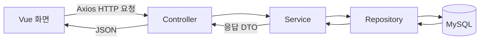
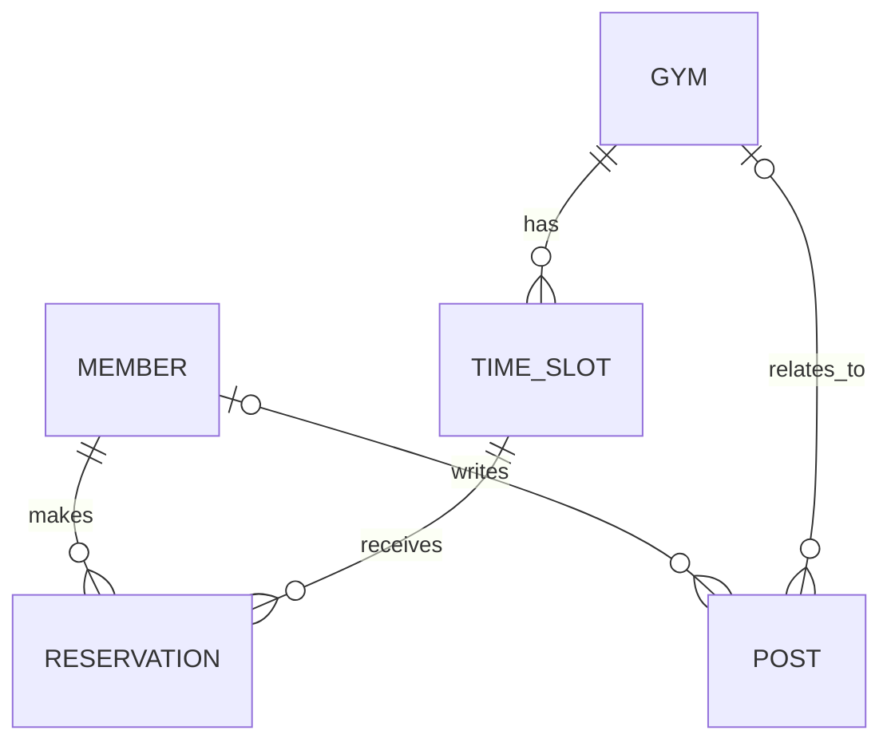

# Climbers’ Hub 프로젝트 정보

> 클라이밍장을 선택하고 날짜·시간대별로 예약하는 서비스. 암장 정보와 게시글 기능을 포함하며, 관리자 예약 승인·거절 기능을 목표로 한다.

## 분석 기준

- 확인일: 2026-10-30
- 백엔드: `C:\dev`
- 프론트엔드: `C:\dev_FE\climbers-hub`
- 소스와 설정 파일을 읽고 정리한 내용이다. 서버 실행 및 테스트 통과 여부는 확인하지 않았다.
- 아래에서 구현되었다는 표현은 관련 코드가 존재한다는 의미이며, 정상 동작을 보장하지 않는다.

## 기술 구성

| 구분 | 사용 기술 |
| --- | --- |
| 백엔드 | Java 17, Spring Boot 3.5.4, Gradle |
| 데이터 접근 | Spring Data JPA, MySQL 드라이버 |
| 인증 | Spring Security, BCrypt, JWT |
| 보조 라이브러리 | Lombok, MapStruct, Springdoc OpenAPI |
| 외부 API 호출 | WebClient — 네이버 지오코딩 호출 |
| 프론트엔드 | Vue 3, JavaScript, Vite |
| 화면 및 상태 | Vue Router, Pinia, Bootstrap |
| HTTP 통신 | Axios |

> [!note] README와 실제 설정의 차이
> README에는 Maven, Spring Boot 3.3.2, React/Next.js 계획이 남아 있다. 현재 구현은 Gradle, Spring Boot 3.5.4, Vue 기반이므로 문서 갱신이 필요하다.

## 폴더 구조

### 백엔드

```text
C:\dev
├─ build.gradle
├─ settings.gradle
├─ gradlew / gradlew.bat
├─ src/main/java/com/climbers/hub
│  ├─ Application.java
│  ├─ auth          # 회원가입·로그인
│  ├─ member        # 회원 관리 및 일부 인증 기능
│  ├─ gym           # 클라이밍장 관리
│  ├─ post          # 게시글 관리
│  ├─ timeslot      # 예약 가능한 요일·시간대·정원
│  ├─ reservation   # 회원의 실제 예약
│  ├─ geocoding     # 주소 → 위도·경도
│  ├─ config        # Security, JWT, CORS, 감사 설정 등
│  ├─ domain        # 공통 BaseEntity
│  └─ mapper        # MapStruct 데이터 변환
├─ src/main/resources/application.yaml
├─ src/main/generated  # 생성된 매퍼 코드
└─ src/test/java/com/climbers/hub
```

기능별 패키지 안에서 Controller, Service, Repository, Domain, DTO 역할을 나눈다. 모든 패키지에 이 구성 요소가 전부 있는 것은 아니다.

| 계층 | 역할 |
| --- | --- |
| Controller | HTTP 요청을 받아 서비스에 전달하고 응답을 반환 |
| Service | 조회·등록·권한 확인 등 업무 로직 처리 |
| Repository | JPA를 통한 DB 접근 |
| Domain | DB에 저장할 엔티티와 관계 정의 |
| DTO | 요청·응답에 필요한 데이터 정의 |

### 프론트엔드

```text
C:\dev_FE\climbers-hub
├─ package.json
├─ vite.config.js
├─ index.html
├─ public
└─ src
   ├─ main.js       # Vue 앱 생성, Router·Pinia·Bootstrap 등록
   ├─ App.vue       # 공통 화면 틀과 RouterView
   ├─ router/index.js
   ├─ views
   │  ├─ Login.vue
   │  └─ Signup.vue
   ├─ stores/counter.js  # 기본 예제 상태
   ├─ components        # Vue 기본 예제 컴포넌트
   └─ assets            # CSS·이미지
```

## 요청 처리 흐름



예를 들어 암장 상세 요청은 `GET /gyms/{gymId}` → `GymController` → `GymService` → `GymRepository` 순서로 처리된다. 서비스는 암장을 찾은 뒤 상세 응답 DTO로 변환한다.

암장 등록 시에는 `GymService`가 `GeocodingService`를 호출하여 입력 주소를 좌표로 변환하고, 암장 정보와 함께 저장한다. WebClient를 사용하지만 현재 응답은 `.block()`으로 기다리는 방식이다.

## 주요 데이터 모델



| 모델 | 주요 정보 및 역할 |
| --- | --- |
| Member | 이름, 이메일, 해싱된 비밀번호, 역할(USER/ADMIN) |
| Gym | 이름, 설명, 주소, 연락처, 위도·경도, 운영시간, 가격 정보 |
| TimeSlot | 소속 암장, 요일, 시작·종료 시간, 정원 |
| Reservation | 예약 회원, 시간대, 실제 예약 날짜, 상태 |
| Post | 제목, 내용, 유형, 작성 회원, 선택적인 소속 암장 |
| BaseEntity | 생성·수정 시각과 생성·수정자 정보를 제공하는 공통 부모 |

`TimeSlot`은 “월요일 19:00~20:00, 정원 10명”처럼 반복되는 시간대를 나타낸다. `Reservation`은 “어떤 회원이 실제 어느 날짜의 시간대를 예약했는지”를 나타낸다.

- 예약 상태: `READY`, `CANCEL`, `DONE`
- 게시글 유형: `GYM_NOTICE`, `GYM_POST`, `GLOBAL_NOTICE`, `GLOBAL_POST`
- 관리자 승인·거절을 어떤 상태로 표현할지는 추가 설계가 필요하다.

## 기능별 진행 상태

| 기능 | 백엔드 | 프론트엔드 |
| --- | --- | --- |
| 회원가입 | 중복 이메일 검사·비밀번호 해싱 코드 존재 | 입력 화면 존재, API 호출 TODO |
| 로그인 | 비밀번호 검증·JWT 발급 코드 존재 | API 호출·토큰 저장 코드 존재 |
| 회원 조회·수정 | API 및 서비스 코드 존재, 수정 매핑 동작 확인 필요 | 화면 없음 |
| 암장 등록·목록·상세 | API 및 서비스 코드 존재 | 화면 없음 |
| 암장 게시글 | 생성·조회·수정·삭제 코드 존재, 실제 로그인 사용자 연결 필요 | 화면 없음 |
| 시간대 | 엔티티·저장소·생성 서비스 존재, Controller 없음 | 화면 없음 |
| 예약 | 엔티티·저장소 존재, 서비스는 비어 있음 | 화면 없음 |
| 관리자 승인·거절 | 계획 단계 | 화면 없음 |

## 현재 API 구성

| 메서드 | 경로 | 역할 |
| --- | --- | --- |
| POST | `/member` | 회원가입 |
| POST | `/member/login` | 로그인 — 현재 프론트엔드 호출 대상 |
| GET | `/member/list` | 전체 회원 조회 |
| GET / PATCH | `/member/{memberId}` | 회원 조회·수정 |
| POST | `/api/auth/signup` | 별도 인증 패키지의 회원가입 |
| POST | `/api/auth/login` | 별도 인증 패키지의 로그인 |
| GET | `/gyms` | 암장 목록 |
| GET | `/gyms/{gymId}` | 암장 상세 |
| POST | `/gyms/create` | 암장 등록 |
| POST | `/gyms/{gymId}/post` | 암장 게시글 생성 |
| GET | `/gyms/{gymId}/post/{postId}` | 암장 게시글 상세 |
| GET | `/gyms/{gymId}/posts` | 암장 게시글 목록 |
| PATCH / DELETE | `/post/{postId}` | 게시글 수정·삭제 |

## 프론트엔드 연결 상태

- `/` → `/login`으로 이동한다.
- `/login` → 로그인 화면을 표시한다.
- `/signup` → 회원가입 화면을 표시한다.
- 로그인은 `http://localhost:8080/member/login`을 호출한다.
- 응답의 Access Token과, 존재하는 경우 Refresh Token을 `localStorage`에 저장한다.
- Pinia는 등록되어 있으나 로그인 상태를 관리하는 별도 스토어는 없다.
- 백엔드 CORS 설정에는 `http://localhost:5173`이 허용되어 있다.

## 인증 구조와 정리할 부분

로그인은 이메일·비밀번호를 검증한 뒤 JWT를 발급한다. 이후 요청에서는 `JwtAuthenticationFilter`가 `Authorization: Bearer ...` 헤더의 토큰을 검증하여 인증 정보를 설정한다.

### 인증 코드 중복

`auth`와 `member` 양쪽에 회원가입·로그인 로직이 있다. `UserDetailsService` 구현도 두 곳에 있으며, 권한 문자열 생성 방식도 다르다. 프론트엔드는 현재 `member` 경로를 사용하므로, 기준이 될 인증 경로를 정하고 통합할 필요가 있다.

### 회원가입 경로와 보안 설정 불일치

`SecurityConfig`는 `/api/members/signup`과 `/member/login`을 인증 없이 허용한다. 실제 회원가입 경로인 `/member`, `/api/auth/signup` 및 별도 로그인 경로 `/api/auth/login`은 이 허용 목록과 맞지 않는다. 비로그인 사용자의 인증 API 접근 설정을 정리해야 한다.

### 로그인 화면의 제출과 이동

`Login.vue`의 폼은 `Login`을 참조하지만 실제 함수는 `login`이다. 버튼 클릭에도 별도 로그인 호출이 연결되어 있다. 폼 제출 이벤트를 하나로 정리할 필요가 있다.

로그인 성공 후 `/`로 이동하지만, 현재 `/`는 다시 로그인 화면으로 연결된다. 로그인 이후 표시할 메인 화면이 필요하다.

### 게시글 작성자 연결

`PostController`의 작성·수정·삭제는 코드에 고정된 이메일을 사용한다. JWT로 인증된 실제 사용자 정보를 사용하도록 연결해야 한다.

### 회원 수정 매핑 확인

현재 `src/main/generated`의 `MemberMapperImpl`에는 값을 변경하는 코드가 없다. `Member`의 변경 메서드 또는 매핑 방식을 확인하고, 재생성된 매퍼와 실제 수정 동작을 검증할 필요가 있다.

## 테스트 현황

- `ApplicationTests`: 애플리케이션 컨텍스트 로딩
- `AuthServiceTest`: 회원가입, 중복 이메일, 로그인 성공·실패
- `MemberControllerTest`: 로그인 API 성공·실패

모두 Spring 컨텍스트를 사용하는 테스트이며, 이번 구조 분석에서는 실행하지 않았다. `AuthServiceTest`의 중복 이메일 기대 메시지와 실제 서비스의 예외 메시지가 다른 점도 확인이 필요하다.

## 권장 개발 순서

- [ ] 인증 경로와 서비스를 하나의 기준으로 정리
- [ ] 보안 설정의 비로그인 허용 경로 수정
- [ ] 프론트엔드 회원가입 API 연결
- [ ] 로그인 폼 제출 이벤트 및 성공 후 이동 수정
- [ ] 로그인 상태·공통 API 클라이언트·토큰 전송 처리
- [ ] 암장 목록 및 상세 화면 연결
- [ ] 시간대 조회·관리 API 구현
- [ ] 예약 생성·내역 조회·취소 구현
- [ ] 날짜·시간대별 정원 확인 및 동시 예약 처리 검증
- [ ] 관리자 승인·거절과 권한 모델 구현
- [ ] 게시글을 실제 로그인 사용자와 연결
- [ ] README와 실행·설정 안내 갱신

첫 번째 완성 목표는 **회원가입 → 로그인 → 암장 목록 → 암장 상세** 흐름이다. 이후 시간대 선택과 예약을 붙여 핵심 사용 흐름을 완성한다.
