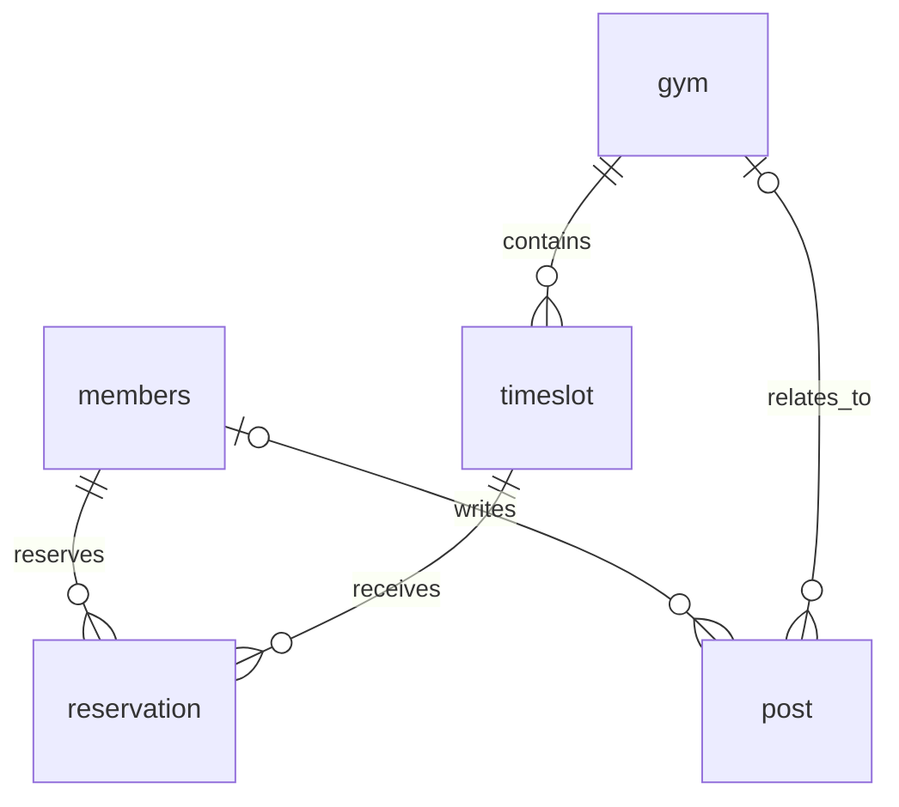

# 엔티티 및 DB 컬럼

프로젝트 개요: [[Project_info]]

## 조회 기준

- 조회일: 2026-10-30
- 스키마: `climber_hub` (MySQL)
- 출처: 실제 DB의 `information_schema.TABLES`, `COLUMNS`, `KEY_COLUMN_USAGE`, `STATISTICS`
- 테이블 5개, 컬럼 총 51개. 데이터 조회·변경 및 DDL 실행 없이 메타데이터만 조회했다.
- 아래 표는 실제 DB의 컬럼 순서를 따른다.

> [!important] DB 코멘트와 설명 구분
> 모든 테이블의 `TABLE_COMMENT`와 모든 컬럼의 `COLUMN_COMMENT`가 빈 문자열이다. 표의 DB COMMENT에서 `없음`은 실제 코멘트가 비어 있다는 뜻이다. ‘설명’은 Java 엔티티와 서비스 코드를 참고해 정리한 것으로, DB에 등록된 코멘트가 아니다.

모든 컬럼의 `COLUMN_DEFAULT` 조회 결과는 SQL `NULL`이다. 이 메타데이터만으로 명시적 `DEFAULT NULL`과 기본값 미지정을 구분할 수 없으므로 별도의 기본값이 확인되지 않은 것으로 해석한다. PK는 모두 `auto_increment`다.

## 테이블 요약

| 테이블 | Java 엔티티 | 컬럼 수 | 역할 | DB 테이블 COMMENT |
| --- | --- | ---: | --- | --- |
| gym | Gym | 13 | 클라이밍장 정보 | 없음 |
| members | Member | 9 | 회원 정보 | 없음 |
| post | Post | 10 | 게시글 | 없음 |
| reservation | Reservation | 9 | 회원 예약 | 없음 |
| timeslot | TimeSlot | 10 | 암장별 예약 가능 시간대 | 없음 |

## gym — 클라이밍장

| 컬럼 | 실제 DB 타입 | NULL 허용 | 키·속성 | DB COMMENT | 설명 |
| --- | --- | --- | --- | --- | --- |
| latitude | double | YES | — | 없음 | 위도 |
| longitude | double | YES | — | 없음 | 경도 |
| created_at | datetime(6) | YES | — | 없음 | 생성 시각 |
| gym_id | bigint | NO | PK, 자동 증가 | 없음 | 암장 식별자 |
| updated_at | datetime(6) | YES | — | 없음 | 최근 수정 시각 |
| address | varchar(255) | NO | — | 없음 | 주소, 지오코딩 입력으로 사용 |
| created_by | varchar(255) | YES | — | 없음 | 생성자 식별 정보 |
| name | varchar(255) | NO | — | 없음 | 암장 이름 |
| open_hours | varchar(255) | YES | — | 없음 | 운영시간 안내 |
| phone | varchar(255) | YES | — | 없음 | 연락처 |
| updated_by | varchar(255) | YES | — | 없음 | 최근 수정자 식별 정보 |
| description | text | YES | — | 없음 | 암장 소개 |
| pricing_info | text | YES | — | 없음 | 이용 요금 안내 |

## members — 회원

| 컬럼 | 실제 DB 타입 | NULL 허용 | 키·속성 | DB COMMENT | 설명 |
| --- | --- | --- | --- | --- | --- |
| created_at | datetime(6) | YES | — | 없음 | 생성 시각 |
| member_id | bigint | NO | PK, 자동 증가 | 없음 | 회원 식별자 |
| updated_at | datetime(6) | YES | — | 없음 | 최근 수정 시각 |
| created_by | varchar(255) | YES | — | 없음 | 생성자 식별 정보 |
| email | varchar(255) | NO | UNIQUE | 없음 | 로그인 이메일, 중복 불가 |
| name | varchar(255) | NO | — | 없음 | 이름 또는 닉네임 |
| password | varchar(255) | NO | — | 없음 | 서비스에서 BCrypt로 해싱하여 저장하도록 구현 |
| updated_by | varchar(255) | YES | — | 없음 | 최근 수정자 식별 정보 |
| role | enum('ADMIN','USER') | NO | — | 없음 | 회원 역할 |

`Member` 생성자는 역할을 `USER`로 설정한다. 이는 애플리케이션 기본값이며, DB 기본값은 확인되지 않았다. 실제 비밀번호 저장 값은 이번 작업에서 조회하지 않았다.

## post — 게시글

| 컬럼 | 실제 DB 타입 | NULL 허용 | 키·속성 | DB COMMENT | 설명 |
| --- | --- | --- | --- | --- | --- |
| created_at | datetime(6) | YES | — | 없음 | 생성 시각 |
| gym_id | bigint | YES | FK, 일반 인덱스 | 없음 | 소속 암장, 전체 게시글은 암장 없이 표현 가능 |
| member_id | bigint | YES | FK, 일반 인덱스 | 없음 | 작성 회원 |
| post_id | bigint | NO | PK, 자동 증가 | 없음 | 게시글 식별자 |
| updated_at | datetime(6) | YES | — | 없음 | 최근 수정 시각 |
| created_by | varchar(255) | YES | — | 없음 | 생성자 식별 정보 |
| title | varchar(255) | NO | — | 없음 | 제목 |
| updated_by | varchar(255) | YES | — | 없음 | 최근 수정자 식별 정보 |
| content | tinytext | NO | — | 없음 | 본문 |
| post_type | enum('GLOBAL_NOTICE','GLOBAL_POST','GYM_NOTICE','GYM_POST') | NO | — | 없음 | 전체·암장 공지 또는 일반 게시글 |

> [!note] 실제 스키마 확인 사항
> `content`의 실제 타입은 `tinytext`다. 긴 본문을 지원하려면 요구사항에 맞춰 타입을 검토해야 한다. 작성 회원은 실제 DB에서 NULL을 허용한다.

## reservation — 예약

| 컬럼 | 실제 DB 타입 | NULL 허용 | 키·속성 | DB COMMENT | 설명 |
| --- | --- | --- | --- | --- | --- |
| reservation_date | date | NO | — | 없음 | 실제 예약 날짜 |
| created_at | datetime(6) | YES | — | 없음 | 생성 시각 |
| member_id | bigint | NO | FK, 일반 인덱스 | 없음 | 예약 회원 |
| reservation_id | bigint | NO | PK, 자동 증가 | 없음 | 예약 식별자 |
| timeslot_id | bigint | NO | FK, 일반 인덱스 | 없음 | 예약 대상 시간대 |
| updated_at | datetime(6) | YES | — | 없음 | 최근 수정 시각 |
| created_by | varchar(255) | YES | — | 없음 | 생성자 식별 정보 |
| updated_by | varchar(255) | YES | — | 없음 | 최근 수정자 식별 정보 |
| status | enum('CANCEL','DONE','READY') | NO | — | 없음 | 예약 상태. 상태별 전이 규칙은 추가 설계 필요 |

## timeslot — 예약 시간대

| 컬럼 | 실제 DB 타입 | NULL 허용 | 키·속성 | DB COMMENT | 설명 |
| --- | --- | --- | --- | --- | --- |
| capacity | int | NO | — | 없음 | 시간대의 예약 정원 |
| end_time | time(6) | NO | — | 없음 | 종료 시간 |
| start_time | time(6) | NO | — | 없음 | 시작 시간 |
| created_at | datetime(6) | YES | — | 없음 | 생성 시각 |
| gym_id | bigint | NO | FK, 일반 인덱스 | 없음 | 소속 암장 |
| timeslot_id | bigint | NO | PK, 자동 증가 | 없음 | 시간대 식별자 |
| updated_at | datetime(6) | YES | — | 없음 | 최근 수정 시각 |
| created_by | varchar(255) | YES | — | 없음 | 생성자 식별 정보 |
| updated_by | varchar(255) | YES | — | 없음 | 최근 수정자 식별 정보 |
| day_of_week | enum('FRIDAY','MONDAY','SATURDAY','SUNDAY','THURSDAY','TUESDAY','WEDNESDAY') | NO | — | 없음 | 예약 가능 요일 |

시간대는 반복되는 요일·시각을 저장하고, 실제 이용 날짜는 `reservation.reservation_date`에서 관리한다.

## 공통 감사 컬럼

`created_at`, `updated_at`, `created_by`, `updated_by`는 모든 테이블에 존재하며 Java의 `BaseEntity`에서 상속한다. 시각과 사용자 정보는 JPA 감사 기능으로 관리하도록 구현되어 있다. DB 조회에서 이 컬럼의 자동 시각 갱신 속성은 확인되지 않았다.

## 외래 키

| 자식 컬럼 | 참조 컬럼 | 제약 이름 |
| --- | --- | --- |
| post.member_id | members.member_id | FK6okhu5mmwauixu447h0fnipql |
| post.gym_id | gym.gym_id | FKqp8lhl3drxw1r1ebmnv7lsc1f |
| reservation.member_id | members.member_id | FK26jrwg2m27qtlfkvfi82yie4o |
| reservation.timeslot_id | timeslot.timeslot_id | FKbq8ayr5v3o8wbx483seomo9wq |
| timeslot.gym_id | gym.gym_id | FK8n0xufpfppn1uolly921awnuy |

외래 키의 삭제·수정 전파 규칙은 이번 조회에 포함하지 않았다.

## 인덱스

| 테이블 | 이름 | 컬럼 | 종류 |
| --- | --- | --- | --- |
| gym | PRIMARY | gym_id | 기본 키 |
| members | PRIMARY | member_id | 기본 키 |
| members | UK9d30a9u1qpg8eou0otgkwrp5d | email | UNIQUE |
| post | PRIMARY | post_id | 기본 키 |
| post | FK6okhu5mmwauixu447h0fnipql | member_id | 일반 |
| post | FKqp8lhl3drxw1r1ebmnv7lsc1f | gym_id | 일반 |
| reservation | PRIMARY | reservation_id | 기본 키 |
| reservation | FK26jrwg2m27qtlfkvfi82yie4o | member_id | 일반 |
| reservation | FKbq8ayr5v3o8wbx483seomo9wq | timeslot_id | 일반 |
| timeslot | PRIMARY | timeslot_id | 기본 키 |
| timeslot | FK8n0xufpfppn1uolly921awnuy | gym_id | 일반 |

조회된 인덱스는 모두 단일 컬럼이다. 예약 날짜를 포함한 복합 인덱스와 예약 중복을 막는 복합 UNIQUE 인덱스는 현재 목록에 없다.

## 유지 관리

엔티티나 스키마를 변경할 때 실제 DB와 비교하여 이 문서를 갱신한다. DB 코멘트를 추가하는 경우에도 코드 기반 설명과 실제 COMMENT를 구분한다. 접속 비밀번호·JWT 키·외부 API 인증 정보는 기록하지 않는다.
