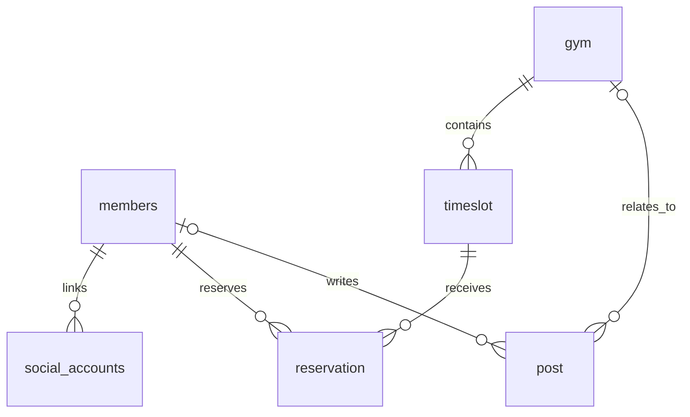

# 엔티티 및 DB 컬럼

프로젝트 개요: [[Project_info]]

## 조회 기준

- 조회일: 2026-10-30
- 스키마: `climber_hub` (MySQL)
- 출처: 실제 DB의 `information_schema.TABLES`, `COLUMNS`, `KEY_COLUMN_USAGE`, `STATISTICS`
- 테이블 6개, 컬럼 총 60개. 2026-10-30 소셜 계정 마이그레이션 후 실제 DB 정의를 재조회했다.
- 아래 표는 실제 DB의 컬럼 순서를 따른다.

> [!important] DB 코멘트와 설명 구분
> 모든 테이블 6개와 컬럼 60개에 한글 COMMENT를 등록했다. 소셜 계정 마이그레이션 후 information_schema에서 변경된 컬럼·코멘트를 재확인했다. 표의 DB COMMENT는 실제 DB에 등록된 값이고, ‘설명’은 코드 기반 보충 설명이다.

모든 컬럼의 `COLUMN_DEFAULT` 조회 결과는 SQL `NULL`이다. 이 메타데이터만으로 명시적 `DEFAULT NULL`과 기본값 미지정을 구분할 수 없으므로 별도의 기본값이 확인되지 않은 것으로 해석한다. PK는 모두 `auto_increment`다.

## 테이블 요약

| 테이블 | Java 엔티티 | 컬럼 수 | 역할 | DB 테이블 COMMENT |
| --- | --- | ---: | --- | --- |
| gym | Gym | 13 | 클라이밍장 정보 | 클라이밍장 정보 |
| members | Member | 10 | 회원 정보 | 회원 정보 |
| social_accounts | SocialAccount | 8 | 회원과 소셜 계정 연결 | 회원별 소셜 로그인 계정 연결 |
| post | Post | 10 | 게시글 | 게시글 |
| reservation | Reservation | 9 | 회원 예약 | 회원 예약 |
| timeslot | TimeSlot | 10 | 암장별 예약 가능 시간대 | 암장별 예약 가능 시간대 |

## gym — 클라이밍장

| 컬럼 | 실제 DB 타입 | NULL 허용 | 키·속성 | DB COMMENT | 설명 |
| --- | --- | --- | --- | --- | --- |
| latitude | double | YES | — | 위도 | 위도 |
| longitude | double | YES | — | 경도 | 경도 |
| created_at | datetime(6) | YES | — | 생성 일시 | 생성 시각 |
| gym_id | bigint | NO | PK, 자동 증가 | 암장 식별 번호 | 암장 식별자 |
| updated_at | datetime(6) | YES | — | 최종 수정 일시 | 최근 수정 시각 |
| address | varchar(255) | NO | — | 암장 주소 | 주소, 지오코딩 입력으로 사용 |
| created_by | varchar(255) | YES | — | 생성자 | 생성자 식별 정보 |
| name | varchar(255) | NO | — | 암장 이름 | 암장 이름 |
| open_hours | varchar(255) | YES | — | 운영 시간 안내 | 운영시간 안내 |
| phone | varchar(255) | YES | — | 암장 연락처 | 연락처 |
| updated_by | varchar(255) | YES | — | 최종 수정자 | 최근 수정자 식별 정보 |
| description | text | YES | — | 암장 소개 | 암장 소개 |
| pricing_info | text | YES | — | 이용 요금 안내 | 이용 요금 안내 |

## members — 회원

| 컬럼 | 실제 DB 타입 | NULL 허용 | 키·속성 | DB COMMENT | 설명 |
| --- | --- | --- | --- | --- | --- |
| created_at | datetime(6) | YES | — | 생성 일시 | 생성 시각 |
| member_id | bigint | NO | PK, 자동 증가 | 회원 식별 번호 (내부 기본 키) | 회원 식별자 |
| login_id | varchar(50) | YES | UNIQUE | 로그인 ID (소문자, 숫자, 밑줄; 소셜 전용 회원은 NULL) | 일반 가입 시 소문자·숫자·밑줄 4~50자 필수, 소셜 전용 회원은 NULL |
| updated_at | datetime(6) | YES | — | 최종 수정 일시 | 최근 수정 시각 |
| created_by | varchar(255) | YES | — | 생성자 | 생성자 식별 정보 |
| email | varchar(255) | YES | UNIQUE | 회원 이메일 (중복 불가; 미제공 시 NULL) | 일반 가입 시 필수. 소셜 가입은 검증된 이메일이 제공될 때만 저장 |
| name | varchar(255) | NO | — | 이름 또는 닉네임 | 이름 또는 닉네임 |
| password | varchar(255) | YES | — | 비밀번호 해시 (BCrypt; 소셜 전용 회원은 NULL) | 일반 가입은 BCrypt 해시, 소셜 전용 회원은 NULL |
| updated_by | varchar(255) | YES | — | 최종 수정자 | 최근 수정자 식별 정보 |
| role | enum('ADMIN','USER') | NO | — | 회원 권한 (ADMIN: 관리자, USER: 일반 회원) | 회원 역할 |

`Member` 생성자는 역할을 `USER`로 설정한다. 이는 애플리케이션 기본값이며, DB 기본값은 확인되지 않았다. 실제 비밀번호 저장 값은 이번 작업에서 조회하지 않았다.

`schema/001_add_login_id.sql`을 실제 DB에 적용했다. 기존 회원 2명에는 `legacy_회원번호`를 부여했으며 PK·비밀번호·기존 외래 키는 유지했다. 마이그레이션 전후 회원 수는 모두 2명이다. SQL은 한 번만 실행하는 수동 마이그레이션이다.

## social_accounts — 소셜 계정 연결

| 컬럼 | 실제 DB 타입 | NULL 허용 | 키·속성 | DB COMMENT | 설명 |
| --- | --- | --- | --- | --- | --- |
| social_account_id | bigint | NO | PK, 자동 증가 | 소셜 계정 연결 식별 번호 | 연결 레코드 번호 |
| member_id | bigint | NO | FK, 복합 UNIQUE | 연결된 내부 회원 식별 번호 | members.member_id 참조 |
| provider | varchar(20) | NO | 복합 UNIQUE | 인증 제공자 (KAKAO, NAVER, GOOGLE) | 현재 카카오만 활성 구현 |
| provider_user_id | varchar(255) | NO | 복합 UNIQUE | 인증 제공자가 발급한 사용자 식별자 | utf8mb4_bin 정렬 규칙 |
| created_at | datetime(6) | YES | — | 생성 일시 | JPA 감사 |
| created_by | varchar(255) | YES | — | 생성자 | JPA 감사 |
| updated_at | datetime(6) | YES | — | 최종 수정 일시 | JPA 감사 |
| updated_by | varchar(255) | YES | — | 최종 수정자 | JPA 감사 |

`UNIQUE(provider, provider_user_id)`와 `UNIQUE(member_id, provider)`로 계정 중복 연결을 방지한다. 설계 및 연결 보안 정책은 [[카카오 로그인 연동]] 참고. `schema/003_social_accounts.sql` 적용 완료, 적용 전후 기존 회원 4명의 행 해시가 일치했다.

## post — 게시글

| 컬럼 | 실제 DB 타입 | NULL 허용 | 키·속성 | DB COMMENT | 설명 |
| --- | --- | --- | --- | --- | --- |
| created_at | datetime(6) | YES | — | 생성 일시 | 생성 시각 |
| gym_id | bigint | YES | FK, 일반 인덱스 | 소속 암장 식별 번호 (전체 게시글은 NULL 가능) | 소속 암장, 전체 게시글은 암장 없이 표현 가능 |
| member_id | bigint | YES | FK, 일반 인덱스 | 작성 회원 식별 번호 | 작성 회원 |
| post_id | bigint | NO | PK, 자동 증가 | 게시글 식별 번호 | 게시글 식별자 |
| updated_at | datetime(6) | YES | — | 최종 수정 일시 | 최근 수정 시각 |
| created_by | varchar(255) | YES | — | 생성자 | 생성자 식별 정보 |
| title | varchar(255) | NO | — | 게시글 제목 | 제목 |
| updated_by | varchar(255) | YES | — | 최종 수정자 | 최근 수정자 식별 정보 |
| content | tinytext | NO | — | 게시글 본문 | 본문 |
| post_type | enum('GLOBAL_NOTICE','GLOBAL_POST','GYM_NOTICE','GYM_POST') | NO | — | 게시글 유형 (GLOBAL_NOTICE: 전체 공지, GLOBAL_POST: 전체 일반, GYM_NOTICE: 암장 공지, GYM_POST: 암장 일반) | 전체·암장 공지 또는 일반 게시글 |

> [!note] 실제 스키마 확인 사항
> `content`의 실제 타입은 `tinytext`다. 긴 본문을 지원하려면 요구사항에 맞춰 타입을 검토해야 한다. 작성 회원은 실제 DB에서 NULL을 허용한다.

## reservation — 예약

| 컬럼 | 실제 DB 타입 | NULL 허용 | 키·속성 | DB COMMENT | 설명 |
| --- | --- | --- | --- | --- | --- |
| reservation_date | date | NO | — | 예약 날짜 | 실제 예약 날짜 |
| created_at | datetime(6) | YES | — | 생성 일시 | 생성 시각 |
| member_id | bigint | NO | FK, 일반 인덱스 | 예약 회원 식별 번호 | 예약 회원 |
| reservation_id | bigint | NO | PK, 자동 증가 | 예약 식별 번호 | 예약 식별자 |
| timeslot_id | bigint | NO | FK, 일반 인덱스 | 예약 시간대 식별 번호 | 예약 대상 시간대 |
| updated_at | datetime(6) | YES | — | 최종 수정 일시 | 최근 수정 시각 |
| created_by | varchar(255) | YES | — | 생성자 | 생성자 식별 정보 |
| updated_by | varchar(255) | YES | — | 최종 수정자 | 최근 수정자 식별 정보 |
| status | enum('CANCEL','DONE','READY') | NO | — | 예약 상태 (READY: 대기, CANCEL: 취소, DONE: 완료) | 예약 상태. 상태별 전이 규칙은 추가 설계 필요 |

## timeslot — 예약 시간대

| 컬럼 | 실제 DB 타입 | NULL 허용 | 키·속성 | DB COMMENT | 설명 |
| --- | --- | --- | --- | --- | --- |
| capacity | int | NO | — | 예약 가능 정원 | 시간대의 예약 정원 |
| end_time | time(6) | NO | — | 종료 시간 | 종료 시간 |
| start_time | time(6) | NO | — | 시작 시간 | 시작 시간 |
| created_at | datetime(6) | YES | — | 생성 일시 | 생성 시각 |
| gym_id | bigint | NO | FK, 일반 인덱스 | 소속 암장 식별 번호 | 소속 암장 |
| timeslot_id | bigint | NO | PK, 자동 증가 | 시간대 식별 번호 | 시간대 식별자 |
| updated_at | datetime(6) | YES | — | 최종 수정 일시 | 최근 수정 시각 |
| created_by | varchar(255) | YES | — | 생성자 | 생성자 식별 정보 |
| updated_by | varchar(255) | YES | — | 최종 수정자 | 최근 수정자 식별 정보 |
| day_of_week | enum('FRIDAY','MONDAY','SATURDAY','SUNDAY','THURSDAY','TUESDAY','WEDNESDAY') | NO | — | 예약 가능 요일 (MONDAY~SUNDAY) | 예약 가능 요일 |

시간대는 반복되는 요일·시각을 저장하고, 실제 이용 날짜는 `reservation.reservation_date`에서 관리한다.

## 공통 감사 컬럼

`created_at`, `updated_at`, `created_by`, `updated_by`는 모든 테이블에 존재하며 Java의 `BaseEntity`에서 상속한다. 시각과 사용자 정보는 JPA 감사 기능으로 관리하도록 구현되어 있다. DB 조회에서 이 컬럼의 자동 시각 갱신 속성은 확인되지 않았다.

## 외래 키

| 자식 컬럼 | 참조 컬럼 | 제약 이름 |
| --- | --- | --- |
| social_accounts.member_id | members.member_id | fk_social_member |
| post.member_id | members.member_id | FK6okhu5mmwauixu447h0fnipql |
| post.gym_id | gym.gym_id | FKqp8lhl3drxw1r1ebmnv7lsc1f |
| reservation.member_id | members.member_id | FK26jrwg2m27qtlfkvfi82yie4o |
| reservation.timeslot_id | timeslot.timeslot_id | FKbq8ayr5v3o8wbx483seomo9wq |
| timeslot.gym_id | gym.gym_id | FK8n0xufpfppn1uolly921awnuy |

외래 키의 삭제·수정 전파 규칙은 이번 조회에 포함하지 않았다.

## 인덱스

| 테이블 | 이름 | 컬럼 | 종류 |
| --- | --- | --- | --- |
| social_accounts | PRIMARY | social_account_id | 기본 키 |
| social_accounts | uk_social_provider_user | provider, provider_user_id | 복합 UNIQUE |
| social_accounts | uk_social_member_provider | member_id, provider | 복합 UNIQUE |
| gym | PRIMARY | gym_id | 기본 키 |
| members | PRIMARY | member_id | 기본 키 |
| members | UK9d30a9u1qpg8eou0otgkwrp5d | email | UNIQUE |
| members | uk_members_login_id | login_id | UNIQUE |
| post | PRIMARY | post_id | 기본 키 |
| post | FK6okhu5mmwauixu447h0fnipql | member_id | 일반 |
| post | FKqp8lhl3drxw1r1ebmnv7lsc1f | gym_id | 일반 |
| reservation | PRIMARY | reservation_id | 기본 키 |
| reservation | FK26jrwg2m27qtlfkvfi82yie4o | member_id | 일반 |
| reservation | FKbq8ayr5v3o8wbx483seomo9wq | timeslot_id | 일반 |
| timeslot | PRIMARY | timeslot_id | 기본 키 |
| timeslot | FK8n0xufpfppn1uolly921awnuy | gym_id | 일반 |

소셜 계정에는 위 복합 UNIQUE 인덱스가 있다. 예약 날짜를 포함한 복합 인덱스와 예약 중복을 막는 복합 UNIQUE 인덱스는 현재 목록에 없다.

## 유지 관리

2026-10-30: 기존 서버 종료 후 누락된 전체 테이블을 종료 직전 백업으로 복원했다. 회원 2명, 로그인 ID, 외래 키 및 코멘트를 복원했으며 5개 테이블의 CHECKSUM이 종료 전과 일치함을 확인했다.

엔티티나 스키마를 변경할 때 실제 DB와 비교하여 이 문서를 갱신한다. DB 코멘트를 추가하는 경우에도 코드 기반 설명과 실제 COMMENT를 구분한다. 접속 비밀번호·JWT 키·외부 API 인증 정보는 기록하지 않는다.

## 코멘트 적용 이력

2026-10-30: `schema/002_add_table_column_comments.sql` 적용 완료. 모든 테이블 5개·컬럼 52개에 코멘트를 등록했다. 전후 DDL을 비교하여 코멘트 외 정의가 동일함을 확인했고, 5개 테이블의 CHECKSUM 값도 모두 일치했다. 생성자·생성 일시·최종 수정자·최종 수정 일시는 각각 `created_by`·`created_at`·`updated_by`·`updated_at`의 코멘트로 등록했다.
