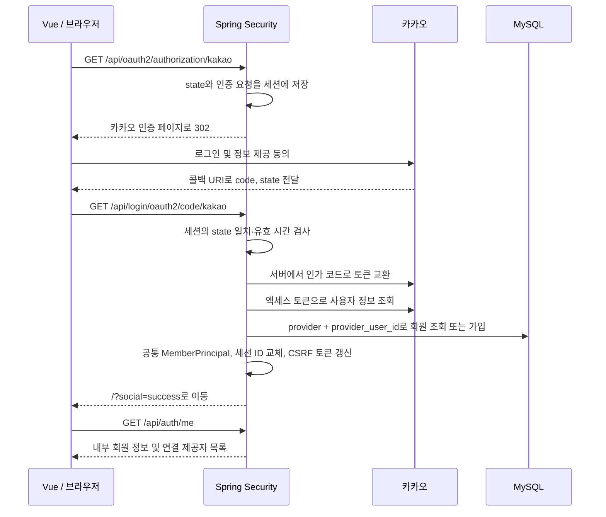
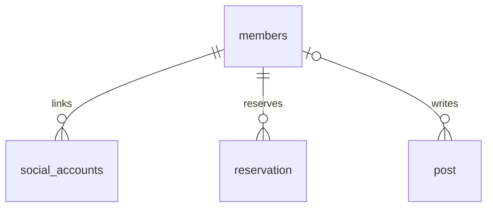

# 카카오 로그인 연동

프로젝트 정보: [[Project_info]] · 실제 DB 정의: [[엔티티]]

## 목표와 범위

일반 ID·비밀번호 로그인과 카카오 로그인이 동일한 내부 회원과 HTTP 세션을 사용한다. 기존 일반 회원도 로그인 후 카카오를 연결할 수 있다. DB와 서비스 계층은 네이버·구글 계정도 연결할 수 있도록 설계하되, 이번 구현에서 실제 제공자 설정·사용자 정보 파싱·화면 연결은 카카오만 지원한다.

회원의 예약·게시글은 기존 `members.member_id`를 계속 참조한다. 이메일이나 소셜 제공자의 ID를 내부 회원 번호로 사용하지 않는다.

## 인증 흐름



카카오 토큰 교환·사용자 정보 조회는 백엔드에서 처리한다. 프론트엔드로 카카오 액세스·리프레시 토큰을 전달하지 않으며 DB·세션에도 보관하지 않는다. 인증 완료 후에는 기존 HttpOnly `JSESSIONID`만 사용한다. 일반 로그인과 마찬가지로 서비스 로그아웃은 서버 세션을 무효화한다.

이번 버전은 OAuth2 인가 코드 + 사용자 정보 조회 방식이다. OIDC는 사용하지 않으며 `openid` scope를 요청하지 않는다.

## 데이터 모델



### members

| 컬럼 | 정책 |
| --- | --- |
| member_id | 기존 숫자 기본 키, 모든 로그인 방식의 공통 회원 식별자 |
| login_id | 일반 가입 시 필수·UNIQUE, 소셜 전용 회원은 NULL |
| password | 일반 가입 시 BCrypt 해시 저장, 소셜 전용 회원은 NULL |
| email | 일반 가입 시 필수·UNIQUE, 소셜 회원은 유효·검증된 이메일이 제공된 경우만 저장 |
| name | 닉네임 사용, 없으면 ‘클라이머’; 최대 50자로 제한 |
| role | 신규 회원은 USER |

소셜 회원을 위해 DB의 `login_id`, `password`, `email`은 NULL을 허용한다. 일반 가입 API의 필수 입력 검증은 유지한다. 가짜 비밀번호·이메일·로그인 ID를 생성하지 않는다.

### social_accounts

| 컬럼 | 타입 | 역할 |
| --- | --- | --- |
| social_account_id | bigint, PK, auto_increment | 소셜 연결 자체의 내부 번호 |
| member_id | bigint, NOT NULL, FK | 연결된 회원 |
| provider | varchar(20), NOT NULL | KAKAO / NAVER / GOOGLE |
| provider_user_id | varchar(255), NOT NULL | 제공자가 발급한 회원 식별자, 문자열로 보관 |
| created_at / updated_at | datetime(6) | 생성 일시 / 최종 수정 일시 |
| created_by / updated_by | varchar(255) | 생성자 / 최종 수정자 |

- `UNIQUE(provider, provider_user_id)`: 소셜 계정 하나가 여러 회원에게 연결되는 것을 방지한다.
- `UNIQUE(member_id, provider)`: 회원 한 명은 제공자별 계정 하나를 연결할 수 있다.
- `fk_social_member`: `members.member_id`를 참조한다.
- `provider_user_id`는 `utf8mb4_bin` 정렬 규칙을 사용한다.
- 모든 테이블·컬럼에 한글 DB 코멘트를 등록했다.

## 기존 일반 회원의 계정 연결

1. 기존 ID·비밀번호로 로그인한다.
2. 회원 홈의 ‘카카오 계정 연결’을 누른다.
3. CSRF 보호가 적용된 `POST /api/auth/social/kakao/link`를 호출한다.
4. 서버가 현재 세션의 내부 회원 번호에 묶인 5분 유효 일회용 연결 티켓을 만든다.
5. 브라우저는 반환된 동일 출처 인증 시작 URL로 이동한다.
6. 인증 시작 시 연결 티켓을 소비하고 회원 번호를 세션에 보관되는 OAuth 인증 요청의 속성에 결합한다. 카카오로 보내는 state는 Spring Security가 별도로 생성한다.
7. 콜백에서 state가 일치하는 인증 요청을 꺼낸 뒤, 연결 대상 회원과 현재 세션의 회원이 같은지 다시 확인한다.
8. 카카오 계정을 해당 회원에 연결하고 동일한 내부 회원으로 세션을 만든다.

클라이언트에서 전달한 회원 번호는 받지 않는다. 로그아웃·계정 변경 등으로 연결 대상 세션이 달라지면 연결을 거절한다. 연결 티켓·인증 요청은 재사용하지 않으며, 세션당 동시에 진행할 수 있는 OAuth 요청은 하나다.

## 가입·충돌 정책

| 상황 | 처리 |
| --- | --- |
| 이미 등록된 카카오 식별자 | 기존 연결 회원으로 로그인 |
| 처음 보는 카카오 식별자, 연결 요청 없음 | 새 회원 + 소셜 계정을 한 트랜잭션에서 생성 |
| 처음 보는 카카오 식별자, 유효한 연결 요청 | 기존 회원에 연결, 기존 프로필·비밀번호는 변경하지 않음 |
| 카카오 계정이 다른 회원에게 연결됨 | 연결 거절 |
| 같은 회원에게 이미 다른 카카오 계정이 연결됨 | 연결 거절 |
| 제공받은 검증된 이메일이 기존 회원과 같음 | 자동 합치기·중복 회원 생성 없이 기존 로그인 후 연결 안내 |
| 이메일이 미제공·미검증 상태 | 이메일 없이 가입 가능 |
| 동시에 동일 소셜 계정으로 가입·연결 | DB 고유 제약으로 중복 방지, 충돌 시 재시도 안내 |

이메일이 없을 경우 기존 계정과 동일인인지 자동 판별할 수 없다. 기존 회원은 반드시 일반 로그인 후 연결 기능을 이용한다. 이미 별도 회원으로 만들어진 두 계정의 예약·게시글 병합은 이번 범위에 포함하지 않는다.

현재 요청 scope는 `profile_nickname`이다. 이메일을 필수로 요구하지 않으며, 카카오가 기존 동의 등으로 이메일을 반환한 경우에도 `is_email_valid`와 `is_email_verified`가 모두 true일 때만 사용한다. 카카오 응답 원본·토큰은 저장하지 않는다.

## 공통 로그인 사용자와 감사 정보

`MemberPrincipal`은 로컬 인증의 `UserDetails`와 소셜 인증의 `OAuth2User`를 함께 구현한다. `getName()`과 `getUsername()`은 내부 `member_id`를 문자열로 반환한다. `/api/auth/me`는 이 번호로 회원을 조회한다.

로컬 로그인 시 비밀번호는 검증 후 자격 증명에서 제거한다. 소셜 로그인 사용자 객체에는 비밀번호나 제공자 토큰을 담지 않는다. 일반 ID·비밀번호 조회는 비밀번호가 있는 회원만 인증 대상으로 삼는다.

`AuditConfig`가 사용하는 인증 이름도 내부 회원 번호 문자열로 통일된다. 따라서 앞으로 생성·수정되는 `created_by` / `updated_by`에는 내부 회원 번호 문자열이 기록된다. 기존 감사 값은 소급 변경하지 않는다. 서버 재시작 시 기존 메모리 세션은 사라지므로 다시 로그인한다.

## API와 화면

| 메서드 | 경로 | 인증 / 역할 |
| --- | --- | --- |
| GET | `/api/auth/social/providers` | 비로그인 허용, 카카오 활성 여부 |
| GET | `/api/oauth2/authorization/kakao` | 카카오 로그인 시작; Axios 대신 페이지 이동 |
| GET | `/api/login/oauth2/code/kakao` | 카카오 콜백; state·세션 검사 |
| POST | `/api/auth/social/kakao/link` | 로그인·CSRF 필요, 일회용 연결 시작 URL 반환 |
| GET | `/api/auth/me` | 기존 API, localLoginEnabled와 linkedProviders 추가 |
| POST | `/api/auth/logout` | 기존 서비스 세션 로그아웃 |

- 로그인 화면: 카카오 활성화 시 노란색 ‘카카오 로그인’ 버튼을 표시한다.
- 회원 홈: 카카오 연결 여부와 ‘카카오 계정 연결’ 버튼을 표시한다.
- 소셜 전용 회원의 없는 ID·이메일은 안내 문구로 표시한다.
- 동의 취소·콜백 오류·연결 충돌은 허용된 오류 코드만 화면에 전달한다. 제공자 응답 원문·시크릿·토큰을 URL에 포함하지 않는다.
- 성공·실패 쿼리는 화면 안내 후 제거한다.
- 카카오 비활성화 시 버튼을 숨기고 일반 로그인을 유지한다.

## 설정 및 로컬 실행

실제 비밀 값은 `C:\dev\src\main\resources\application-secret.yaml`에서 읽는다. 저장소에는 값이 없는 `application-kakao-example.yaml`만 포함하며 자동으로 import하지 않는다.

```yaml
app:
  oauth:
    frontend-base-url: "http://localhost:5173"
    kakao:
      enabled: true
      client-id: "REST_API_KEY"
      client-secret: "CLIENT_SECRET"
      redirect-uri: "http://localhost:5173/api/login/oauth2/code/kakao"
```

카카오 Developers에서 로그인 사용 설정 ON, REST API 키의 클라이언트 시크릿 ON, 닉네임 동의항목 사용 설정을 확인한다. Redirect URI에는 위 `redirect-uri`와 완전히 동일한 값을 등록한다.

프론트 5173의 `/api`는 백엔드 8080으로 전달되므로, 인증 시작과 콜백을 모두 `http://localhost:5173`에서 처리한다. `localhost`와 `127.0.0.1`을 섞지 않는다. 카카오 버튼 클릭 시 프론트와 백엔드 모두 실행 중이어야 한다.

운영 환경에서는 HTTPS 동일 출처 프록시와 운영 콜백 주소를 사용하고, `SESSION_COOKIE_SECURE=true`를 설정한다. 완료 후 돌아갈 프론트 주소는 서버 설정의 HTTP(S) origin으로 고정하며 요청 파라미터로 임의의 리다이렉트 주소를 받지 않는다.

## 마이그레이션

`schema/003_social_accounts.sql`을 기존 DB에 한 번 적용한다. 이번 로컬 DB에는 적용 완료했다. 적용 직전 백업을 만들었으며 기존 회원 4명은 각 행의 해시를 비교해 내용이 보존됐음을 확인했다. 기존 기본 키·외래 키는 유지했다. 현재 DB는 테이블 6개, 컬럼 60개다.

일반 환경의 `ddl-auto: validate`는 유지한다. 테스트의 `create-drop`은 실제 MySQL과 분리된 H2 프로필에서만 사용한다.

## 검증

최종 결과: `gradlew test` 22개 통과(실패 0). `ApplicationTests` 1개, `SessionAuthenticationTest` 5개, `KakaoLoginTest` 13개, `KakaoProfileTest` 3개. 프론트엔드 변경 파일 ESLint 및 `npm run build` 통과. 임시 검증 서버는 종료했다.

- H2 + MockMvc로 일반 로그인 회귀 및 모의 카카오 토큰·프로필 응답을 사용한 전체 콜백 흐름을 테스트한다.
- 신규 가입·재로그인·이메일 없음·이메일 충돌·기존 회원 연결·다른 회원의 카카오 탈취 거부·두 번째 카카오 연결 거부·연결 세션 유실·일회용 티켓·state 변조·콜백 재사용·동의 취소를 검증한다.
- 서비스 트랜잭션 밖에서 재로그인해도 회원 정보가 정상 조회되는지 검증한다.
- 실제 MySQL 스키마 검증 및 실제 설정으로 카카오 인가 URL 302 응답, state 포함, 콜백 URI 일치를 확인했다.
- 프론트엔드 ESLint와 운영 빌드를 수행했다.
- 실제 카카오 계정으로 로그인·동의하는 최종 단계는 사용자가 브라우저에서 확인해야 한다. 아직 실제 토큰 교환 성공까지 확인한 것으로 간주하지 않는다.

## 확장 계획

네이버·구글 추가 시 제공자 등록 설정과 응답→`SocialIdentity` 파서를 추가하고, 제공자별 인증 시작·연결 티켓 경로를 확장한다. 기존 `social_accounts` 모델과 공통 회원·세션 로직은 재사용한다. GOOGLE 식별자는 OIDC `sub`, NAVER 식별자는 해당 제공자의 사용자 ID처럼 안정적인 식별자를 사용한다.

추가 설계가 필요한 기능:

- 소셜 계정 연결 해제: 마지막 로그인 수단을 제거하지 못하도록 검사, 카카오 연결 해제 API와 동기화 정책 필요
- 소셜 전용 회원의 로컬 ID·비밀번호 등록: 최근 재인증·ID 중복 검증 필요
- 계정 병합: 양쪽 계정의 본인 확인 및 예약·게시글 이관 정책 필요
- 탈퇴·제공자 연결 해제 웹훅: 재가입·데이터 보관 정책 필요
- 중요 계정 변경 전 재인증과 로그인 시도 제한

## 공식 참고 자료

- [카카오 로그인 REST API](https://developers.kakao.com/docs/ko/kakaologin/rest-api)
- [카카오 로그인 설정](https://developers.kakao.com/docs/ko/kakaologin/prerequisite)
- [Spring Security 6.5 OAuth2 Login 설정](https://docs.spring.io/spring-security/reference/6.5/servlet/oauth2/login/advanced.html)
